# 拾光笔记架构设计说明书

副标题：小红书核心业务复刻与创新——五视图架构设计  
版本：V1.0，设计交付版（尚未实现）  
日期：2026-11-01  
组队形式：个人  
学号、姓名：未提供，提交前由本人补充  
教师选题批准情况、实际截止日期：未提供  
在线地址、测试账号、源码仓库：尚未建立；不得作为已部署证据  

## 文档状态与阅读方式

本设计依据《软件体系架构》任务书、两份附录和需求规格说明书。用户已明确选择：8个模块、3类角色、两项创新、Vue 3、模块化单体加分层与RabbitMQ异步；本地Docker Compose部署，另列云演进。Java 21、MySQL、MyBatis-Plus、Redis、RabbitMQ为固定条件。

技术细节由本设计给出，涉及的线程数、资源配额、超时、算法权重均为工程设计值，而非用户提供的实际资源或实测结果。未完成的执行证据集中列于第9章，不以占位测试截图或虚构地址补齐。

配套文件：`数据字典.md`逐字段定义全部表；`接口设计说明.md`和`attachments/openapi.yaml`定义接口；`attachments/schema.sql`为DDL契约；`开发实施计划.md`给出任务与验收；`adr/`保存完整决策；`images/`保存可编辑图源和矢量图。它们与本文共同构成开发文档。

正文中文微软雅黑、小四（12pt）、1.5倍行距；PDF含目录、页眉与页码/总页数。图表按章编号、来源均为自绘/本项目设计，引用资料编号见附录D。逻辑静态图以C4的系统、容器、组件层级为主；时序、状态、类关系与ER采用附录B明确的辅助建模符号，不把ER图当成C4容器图。

修订记录：V0.1为既有需求审核稿；本次用户确认方案后形成V1.0架构设计。尚无V1.1第三版，不伪造课程所需的三次演进记录，后续真实修订继续记录。

## 1 需求概述

### 1.1 背景、目标与系统边界

拾光笔记面向生活经验的发现、记录与实践。基础体验复刻小红书图文社区：发现瀑布流、图文发布、话题搜索、点赞评论、关注收藏、消息和内容治理。不复制商标素材，不宣称还原原平台内部架构；UI只复刻业务形态。

创新一是可解释推荐：用户可知道内容来自兴趣、关注或热门，并可降低话题权重、隐藏单条、恢复偏好。创新二是收藏后的实践闭环：从想尝试到完成，记录实际体验，默认私有；公开反馈须审核且随原笔记失效。

不实现直播、视频转码、电商支付、真实短信、实时私信、原生App与付费大模型。本期搜索采用MySQL，媒体保存到本地受保护持久卷；两者预留替换端口，不额外引入搜索集群或对象存储服务。

验收目标：27条FR全部可运行；三角色与私有数据隔离；笔记至少6状态；RabbitMQ真实异步；创作者、运营、治理统计可核验；五视图和代码结构可追溯。当前为设计交付，业务完成率尚不可计算。

### 1.2 角色与用例

表1-1 角色权限（来源：本项目需求）

| 角色 | 可见范围 | 可操作 | 不能做 |
|---|---|---|---|
| USER | 公开内容、本人草稿/收藏/实践/通知/统计 | 创作、互动、举报、推荐设置 | 他人私有数据、审核、改权 |
| REVIEWER | 有效审核任务绑定内容、举报所需证据、治理统计/审计 | 通过/驳回、下架、隐藏、举报结案 | 自审、任意查看私人收藏、管理角色 |
| ADMIN | 脱敏账号、权限配置、平台统计和审计 | 改权、封禁、话题配置 | 默认执行审核、读取密码或会话令牌 |

游客是未登录状态，只访问公开查询，不计入三类角色。角色可以组合，但ADMIN不隐式包含REVIEWER。审核账号仍可发布，因此禁止自审并提供另一审核账号；个人开发者可以使用不同测试账号演示不同职责，不能声称多人完成。

### 1.3 功能需求和规模

表1-2 模块与需求覆盖（来源：需求稿，完整验收条件沿用）

| 模块标识/代码名 | 子功能 | FR | 复杂度 |
|---|---|---|---|
| M1 identity | 注册登录退出、公开/本人资料、角色封禁 | 01–03 | C1 |
| M2 content | 草稿、图片、发布/重审/删除 | 04–07 | C1/C2/C3 |
| M3 discovery | 发现关注流、检索、兴趣解释与调节 | 08–11 | C1/C4 |
| M4 social | 点赞、两级评论、关注关系 | 12–14 | C1/C3/C4 |
| M5 collection | 私有收藏夹、收藏、实践与公开反馈 | 15–18 | C1/C2/C4 |
| M6 notification | 互动通知、治理通知、未读管理 | 19–21 | C1/C3 |
| M7 governance | 内容审核、举报、话题及审计 | 22–24 | C1/C2/C3 |
| M8 statistics | 作者、平台、治理和实践看板 | 25–27 | C1/C4 |

每个模块有独立责任、API契约和代码包，不按CRUD拆分凑数。8模块超过个人最低6模块，保留全部是用户已确认范围。C1三角色；C2笔记和实践状态；C3消息；C4聚合与可视化全部落实到设计。

### 1.4 质量属性与约束

表1-3 质量属性场景（来源：需求稿；数值为待测目标）

| 属性 | 刺激/环境 | 响应与度量 |
|---|---|---|
| 安全正确性，优先1 | 未认证、越权、封禁、内容下架 | 测试集拦截100%；不可见正文/媒体不返回；状态转换不越界 |
| 可维护性，优先2 | 新增/修改业务能力 | API边界、纯领域规则、自动依赖检查；核心领域/应用行覆盖率≥70% |
| 性能，优先3 | 1万篇笔记、混合100QPS、预热后 | 列表/详情P95≤500ms、普通写P95≤800ms、非注入错误<1% |
| 异步及时性 | 正常依赖、业务提交后 | 通知95%≤5秒、99%≤30秒；计数≤30秒更新 |
| 可靠性 | MQ中断后恢复 | 已提交事件可补发；测试积压恢复后5分钟内追平，规模须记录 |
| 并发正确性 | 重复点赞/关注、并发审核、重放消息 | 无重复事实/通知、无非法状态、无负计数 |
| 启动性 | Docker和网络等前提已满足 | 按README在10分钟内启动；首次镜像下载单独计时 |
| 灾备 | 磁盘/数据故障 | RPO≤24小时、RTO≤2小时，须以真实备份恢复演练验证 |
| 可用性 | Redis故障 | 公共读取在降级负载内可用，安全校验不能放宽；不承诺单机99.99% |
| 易用性 | 360px/1440px、键盘访问 | 核心流程无阻断溢出，有标签、焦点和可读错误 |

初始容量假设：注册1万、DAU1000、日请求10万、日增200篇、平均3图×1MB。本地建议Docker分配4核8GiB、磁盘至少60GiB可用；这不是已检测到的主机配置。开发电脑还需IDE与浏览器余量，建议物理内存16GiB以上。若实际不足，只调整压测和监控配置，不取消权限/状态/消息正确性。

## 2 架构总览

### 2.1 架构风格与备选

采用模块化单体：一个Java进程、一个MySQL实例、八个业务包；Web接入与跨模块用例编排位于上层，模块内采用接入无关API、应用服务、纯领域和基础设施实现；异步事件只处理通知、缓存和统计等非即时结果。

表2-1 风格比较（来源：本项目设计）

| 候选 | 收益 | 代价 | 决策 |
|---|---|---|---|
| 全部业务堆在Controller/CRUD Service | 最少初期文件 | 边界不可核验、审核/权限复用差 | 否决 |
| 模块化单体+分层+异步 | 本地事务、低部署成本、能表达8业务边界 | 用例层多一层编排，必须自动约束包依赖 | 用户选择，采用 |
| 微服务+分布式事务 | 独立发布扩缩容 | 个人作业规模下治理和资源成本过高 | 本期否决，增长后按边界迁移 |

不用通用CRUD是为了将状态、权限和幂等表达为业务规则；不用更复杂微服务是因为目前没有独立团队、独立发布或资源隔离需求。数据库跨模块写入只能通过拥有者API，不通过共享Mapper快捷修改。

### 2.2 上下文与外部边界

图2-1 系统上下文（来源：自绘）

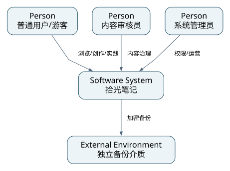

用户、审核员、管理员通过浏览器使用同一系统。外部只规划备份介质和可选云资源；MySQL、Redis、RabbitMQ、媒体卷都属于本系统容器边界内部。媒体文件适配器采用操作系统文件API，不把内部文件系统虚称为已接入OSS。云对象存储是备选架构，不是当前外部系统。

### 2.3 架构策略

表2-2 最高质量属性贯穿（来源：自绘）

| 目标 | 策略 | 视图 |
|---|---|---|
| 安全与正确性 | DB权威身份/可见性、版本化审核、事务+唯一键+Outbox、媒体请求鉴权 | 全部五视图 |
| 可维护性 | 共享契约、模块API、纯领域、编排层、依赖门禁、契约同步 | 逻辑/开发/数据 |
| 有界性能 | Redis可丢缓存、索引分页、候选快照、批量统计、有限线程池 | 数据/运行/物理 |

### 2.4 ADR索引

表2-3 ADR汇总（来源：adr目录；状态为设计采纳，未实测）

| 编号 | 决策 | 视图 |
|---|---|---|
| ADR-001 | Java21+Spring Boot3.5，避免首期Boot4迁移面 | 开发/运行 |
| ADR-002 | Vue3+TypeScript+Vite，一个用户/后台工程 | 开发/逻辑 |
| ADR-003 | MySQL8.4+MyBatis-Plus，领域和持久化对象隔离 | 数据/开发 |
| ADR-004 | Redis仅可重建缓存，不承担唯一登录撤销事实 | 数据/运行 |
| ADR-005 | DB权威随机会话+HttpOnly Cookie+CSRF | 逻辑/数据/运行 |
| ADR-006 | 单机Compose，媒体私有持久卷，监控可选profile | 物理/开发 |
| ADR-007 | 定向Outbox+RabbitMQ+Inbox，至少一次与补偿 | 数据/运行 |
| ADR-008 | 八模块+上层用例编排，模块间无直接代码依赖 | 逻辑/开发 |
| ADR-009 | 图像经后端授权、重编码、no-store，不发公开直链 | 逻辑/物理 |
| ADR-010 | 审核绑定revision；重审暂停公开，反馈绑定源revision | 全部 |
| ADR-011 | 可解释规则排序、短期推荐快照及偏好失效 | 逻辑/数据/运行 |
| ADR-012 | 事实重算计数、事件日指标、显式水位与对账 | 数据/运行 |

## 3 逻辑架构视图

### 3.1 功能结构与C4容器

图3-1 功能结构（来源：自绘）

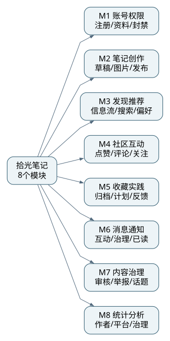

八模块各覆盖表1-2子功能；重点实现内容发布与审核、社区互动、可靠通知和两项创新。它们均为本期核心，不能把未实现项标为低优先级规避验收。

图3-2 容器与协议（来源：自绘）

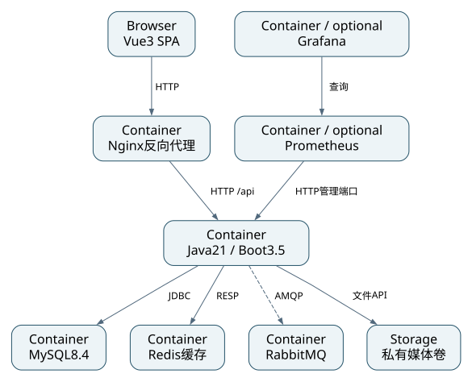

浏览器加载Vue构建制品；Nginx代理/api到Java，应用通过JDBC、RESP、AMQP访问MySQL、Redis、RabbitMQ；图像通过受保护文件适配器读写。Nginx是反向代理，不额外增加Spring Cloud Gateway/BFF。Prometheus/Grafana只在monitor profile启用。

### 3.2 分层与禁止依赖

图3-3 编译期分层（来源：自绘）

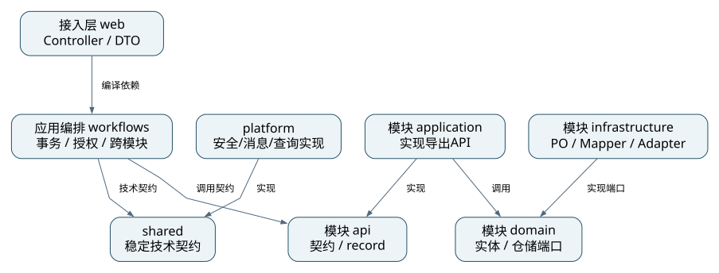

规范包名前缀为`cn.shiguang.notes`。八个模块`modules.<name>`均有`api/application/domain/infrastructure`。API仅包含导出接口、命令与返回记录；application实现API并调用domain与domain定义的仓储端口；infrastructure实现仓储/媒体端口。模块application不导入infrastructure，运行时由Spring装配。

跨模块命令编排位于`workflows`，例如提交笔记同时调用ContentApi和GovernanceApi，并在同一数据库事务写入review、outbox及幂等结果。Controller在`web`，只调用workflow入口。模块不能调用workflows，也不能导入另一模块的任何包；跨域同步查询由workflow取得API结果组合。复杂列表通过`platform.readmodel`只读SQL批量连接已约定表，作为查询端口实现，不可写其他模块的表。

表3-1 强制依赖规则（来源：本项目设计）

| ID | 规则 | 执行验证 |
|---|---|---|
| DEP-01 | web→workflows→各模块api；Controller不直调Mapper/Repository | ArchUnit+包扫描 |
| DEP-02 | api/domain不依赖Spring、MyBatis、Servlet；domain不依赖application | ArchUnit |
| DEP-03 | application→api/domain/shared；infrastructure→domain/api/shared；反向禁止 | ArchUnit |
| DEP-04 | 一个业务模块不得import另一模块，不得依赖web/workflows | ArchUnit与清单 |
| DEP-05 | platform.readmodel只读，允许跨表SELECT，禁止跨域写Mapper | SQL/代码评审 |
| DEP-06 | 事务边界只在workflows或platform.application的public用例；不在Controller/Repository | 注解扫描；集成测试 |
| DEP-07 | shared不含业务Service，不成为绕过边界的“公共业务层” | Code Review |

platform接口如EventAppender、CommandDeduplicator、Clock、MediaStoragePort在shared的技术契约中定义，其实现在platform。模块应用层可依赖这些接口；不依赖平台具体实现。Spring启动装配可扫描所有包，作为构造入口的技术例外，不代表业务依赖许可。

### 3.3 领域模型与聚合

图3-4 核心领域关系（来源：自绘）

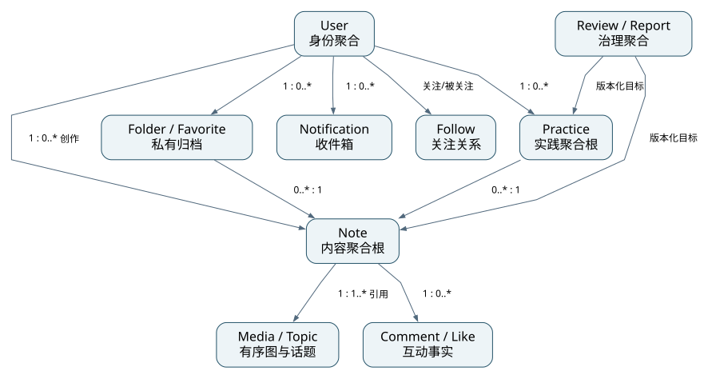

核心实体至少包括User、Note、Media、Topic、Comment、Follow、Folder、Favorite、Practice、Review、Report、Notification，共12类。Note为内容聚合根，拥有有序图和话题引用；Practice为收藏实践聚合根，拥有结果图片与状态历史；Review/Report分别管理治理工作流；Folder拥有Favorite条目，删除收藏夹不删除Note或Practice。

表3-2 聚合职责（来源：自绘）

| 聚合/实体 | 核心规则 | 数据映射 |
|---|---|---|
| User/Session | 账号唯一、状态/授权版本、不可移除最后管理员 | user/role/user_role/session |
| Note | 40字标题、2000字正文、1–9图、1–5话题、状态与revision | note/note_media/note_topic/media |
| Social关系 | 点赞/关注唯一，禁自关；评论最多两级展示 | like/follow/comment |
| Folder/Favorite | 私有、owner一致、同夹去重、跨夹人数去重 | folder/favorite |
| Practice | 本人状态转换；DONE后结果；公开需有效审核与源revision | practice/practice_media/practice_history |
| Review | 非本人审核；只决策同版本PENDING任务 | review |
| Report | 同人同目标开放工单唯一、结案释键、理由与审计 | report/audit |
| Notification | 本人收件箱、事件唯一、不存目标敏感正文 | notification |

DDD采用轻量限界上下文，不声称每个表都是聚合根。仓储接口是依赖倒置模式；推荐采用策略模式；事件消费是观察者式协作。每个模式须在最终代码索引中对应真实实现，不能只列名称。

### 3.4 对外与内部接口

外部75个HTTP操作的请求、响应、权限、错误见接口附件，OpenAPI为机器可读契约。内部统一ID为long，外部序列化字符串；领域状态枚举不以随意整数跨层传递。内部接口值对象均不可变record。

表3-3 关键内部契约（来源：自绘）

| 所属API/入口 | 签名（设计） | 前置/后置 | 失败 |
|---|---|---|---|
| ContentApi | `NoteSnapshot submit(long actorId,long noteId,int version)` | 本人DRAFT且完整→PENDING；调用方负责审核任务同事务 | NoteInvalid/VersionConflict |
| GovernanceApi | `ReviewSnapshot openReview(ReviewTarget target,long applicantId)` | 同类型/ID/revision唯一；返回既有或新任务 | TargetInvalid |
| workflows | `VersionResult decideReview(long actorId,long reviewId,ReviewDecision cmd,String key)` | 审核员非本人且版本有效；任务/目标/审计/消息同事务 | Forbidden/StaleReview |
| SocialApi | `boolean ensureLike(long actorId,long noteId,boolean desired)` | 已经在workflow实时校验可见；仅实际变化返回true | Duplicate约束转换为幂等结果 |
| CollectionApi | `PracticeSnapshot transition(long actorId,long practiceId,int version,PracticeStatus to)` | 所有人且合法迁移；历史一并写入 | InvalidTransition |
| DiscoveryApi | `CardPage recommend(long viewerId,FeedQuery query)` | 当前偏好；最终批量过滤可见性与隐藏 | SnapshotExpired |
| NotificationApi | `void receive(EventEnvelope event)` | 和inbox同事务；同收件人/事件唯一 | 可重试失败不ACK |
| shared | `void append(EventEnvelope event,Set<ConsumerName> recipients)` | 已有事务；按收件消费者写定向Outbox | 写失败整体回滚 |

`EventEnvelope`固定字段：eventId(UUID)、eventType、schemaVersion=1、occurredAt(UTC)、actorId、aggregateType、aggregateId、aggregateRevision、traceId、payload。载荷仅必要ID/动作/指标，不包含密码、令牌、私有正文和图片路径。

### 3.5 逻辑协作与外部依赖场景

图3-5 提交笔记的跨模块场景（来源：自绘）

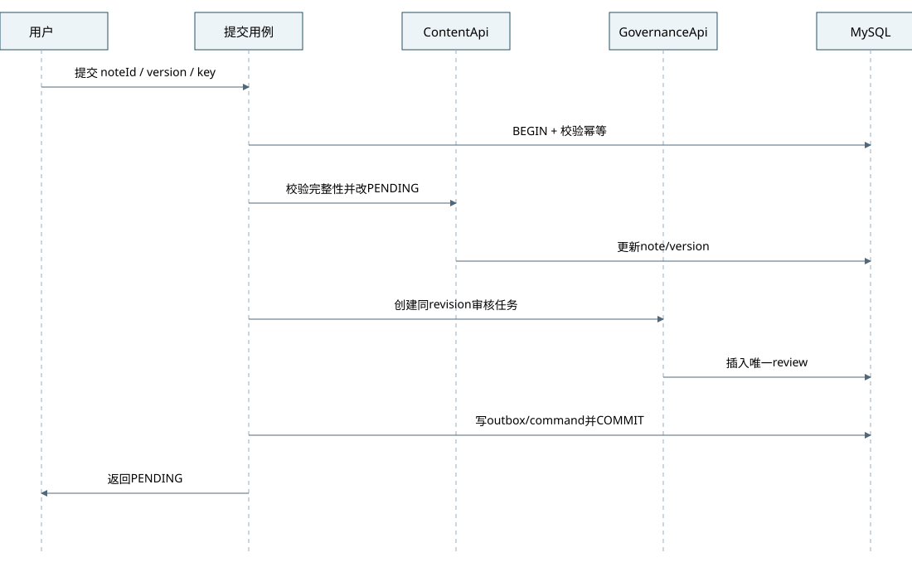

提交用例先校验身份和version，再调用ContentApi变更状态、GovernanceApi创建同revision任务，并写Outbox和命令幂等结果。同一个MySQL事务提交成功后返回PENDING；通知此时尚未处理也不影响业务成功。任何一步失败全部回滚。

图3-6 上传图片与操作系统交互（来源：自绘）

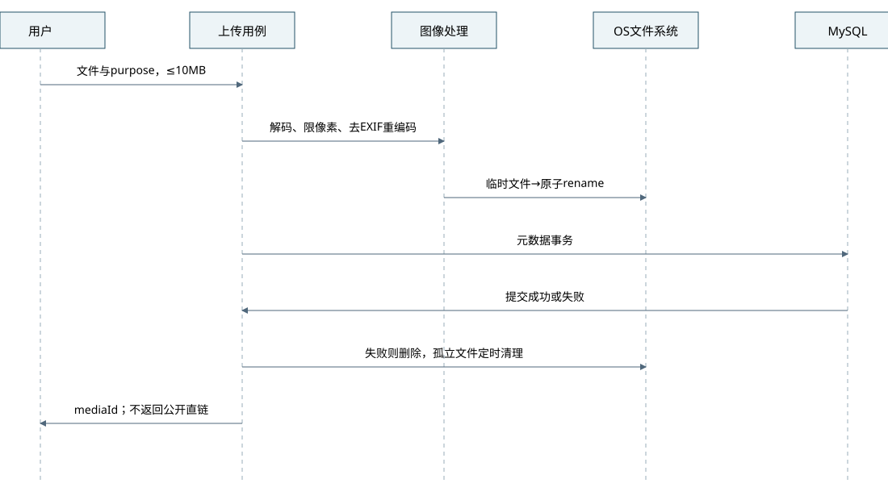

图3-6展示操作系统环境交互：流式限额→实际解码/像素限制→重编码去EXIF→随机路径临时文件→原子rename→元数据事务。文件成功但元数据失败则立即删除，失败留清理记录/扫描；数据库成功后文件需在持久卷存在。此图不计作L7的独立外部系统调用证据，不冒充第三方云API。

图3-8 调用独立消息系统（来源：自绘）

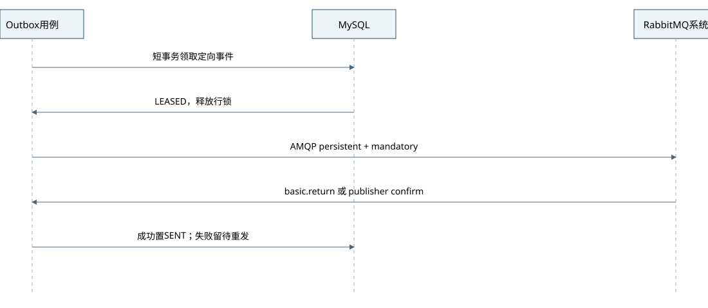

本图满足L7的外部系统调用场景：RabbitMQ是独立运行、通过AMQP调用的依赖系统，相对于Java应用进程边界在外，相对于整个产品部署边界在内。领取事件后释放数据库事务，再调用Broker；mandatory不可路由和confirm超时都不能记为消费成功。课程未要求付费或第三方云，不为凑图虚构OSS或短信集成。L7验收采用3-5跨模块、3-8独立系统、3-7异常，3-6作为附加媒体交互。

图3-7 过期审核的失败场景（来源：自绘）

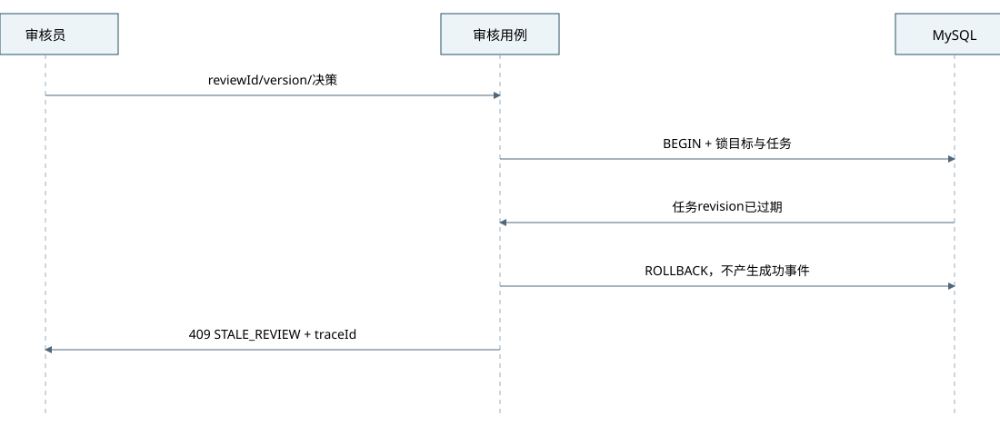

审核目标revision已变化或任务不再PENDING时，决策409，不更新目标、不写成功审计和通知；登录/角色/自审校验失败为401/403。错误含traceId但不返回SQL/栈信息。

### 3.6 模块依赖矩阵与度量

表3-4 编译期依赖矩阵（1=允许，0=禁止；来源：自绘）

| 源→目标 | identity | content | discovery | social | collection | notification | governance | statistics | shared |
|---|---|---|---|---|---|---|---|---|---|
| identity | 内部 | 0 | 0 | 0 | 0 | 0 | 0 | 0 | 1 |
| content | 0 | 内部 | 0 | 0 | 0 | 0 | 0 | 0 | 1 |
| discovery | 0 | 0 | 内部 | 0 | 0 | 0 | 0 | 0 | 1 |
| social | 0 | 0 | 0 | 内部 | 0 | 0 | 0 | 0 | 1 |
| collection | 0 | 0 | 0 | 0 | 内部 | 0 | 0 | 0 | 1 |
| notification | 0 | 0 | 0 | 0 | 0 | 内部 | 0 | 0 | 1 |
| governance | 0 | 0 | 0 | 0 | 0 | 0 | 内部 | 0 | 1 |
| statistics | 0 | 0 | 0 | 0 | 0 | 0 | 0 | 内部 | 1 |
| workflows | api | api | api | api | api | api | api | api | 1 |

八业务模块之间编译依赖边为0，workflow扇出为8（按模块类别计，不是每个用例都调用8个）。workflow与readmodel提供显式跨域协作，因此“无直接依赖”不意味着没有运行时协作。设计有向图无环，最终需扫描源码验证；目前没有代码，不能声称实际ArchUnit已通过。

## 4 数据架构视图

### 4.1 ER、数据字典与归属

图4-1 业务实体关系总览（来源：自绘；完整FK见schema.sql）

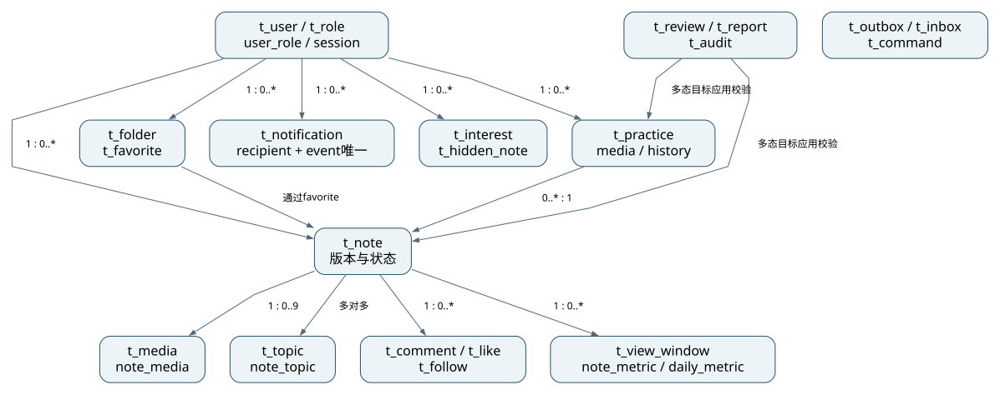

图4-1是分组概览；完整30实体、逐字段PK/FK与基数见`images/4-1-er-full.mmd`及同名SVG，不能用概览替代字段级ER。领域模型另附`images/3-4-domain-class.mmd`的12类属性/行为/关系。字典覆盖全部核心表，包括身份、内容、关系、实践、治理、通知、可靠事件和统计。所有字段有类型/长度、可空、默认值、约束和业务含义；DDL从同一模型生成，避免手工维护两套名称。图片字节不放数据库，数据库只存随机key与元信息。多态举报/审核目标不设置虚假FK，改为事务内存在性与类型校验。

主键自增BIGINT UNSIGNED；InnoDB、utf8mb4、UTC DATETIME(3)；外部ID为字符串。笔记以业务DELETED终结，不一概用MyBatis逻辑删除，避免重复关系与唯一键冲突。关系取消物理删除，历史事件保存在Outbox审计链中；用户本期不提供物理注销，避免破坏治理追溯。

### 4.2 存储选型与分布

表4-1 存储矩阵（来源：自绘；依据[R1][R3][R4][R6]）

| 数据 | 本期 | 备选及否决理由 |
|---|---|---|
| 账号/笔记/关系/治理/会话 | MySQL8.4事务库 | 文档库未能减少关系/一致性成本；不以框架示例误称其他库无事务 |
| 高频可重建信息流/计数/配置 | Redis，统一256MiB上限起步 | 仅JVM缓存难跨实例一致失效；本期不存唯一安全事实 |
| 图片 | 受保护本地持久卷+后端字节代理 | 对象存储本期增加容器和运维成本；云端转S3兼容端口 |
| 搜索 | MySQL字段查询+必要ngram FULLTEXT | Elasticsearch首期资源过高；必须在真实中文数据集核验分词和EXPLAIN |
| 消息 | RabbitMQ；MySQL Outbox为可靠重发依据 | 仅内存事件无法应对进程崩溃；Kafka不符合用户指定且规模不需 |
| 图表 | MySQL聚合表+Redis短缓存 | 前端循环请求或逐行查库不满足课程要求 |

表4-2 演进触发（均为设计阈值，来源：自绘）

| 策略 | 本期 | 触发与预留 |
|---|---|---|
| 读写分离 | 不做 | 主库CPU>70%持续15min且查询占比>80%，先优化索引；公开列表可读副本，鉴权/可见性及写后读保持主库 |
| 分库分表 | 不做 | 单表>5000万或索引/存储/维护窗口不满足，实测后评估；统一ID适配器、按业务边界迁移，不提前假设分片方案 |
| 冷热分离 | 部分保留期清理 | 业务事件保留90日；日志30日、审计180日；>90日可脱敏归档并记录校验值 |
| 搜索引擎 | 不做 | 10万篇以上中文检索P95持续>500ms且索引优化无效；独立索引适配器，公开结果仍回主库过滤 |

### 4.3 事务、一致性与并发

表4-3 一致性边界（来源：自绘）

| 场景 | 要求 | 方案 | 补偿 |
|---|---|---|---|
| 笔记提交/审核/撤回 | 强一致 | 目标、review、审计、Outbox、command同库事务 | 任一步失败回滚；异常任务取消 |
| 点赞/关注/收藏事实 | 强一致 | 唯一键+明确设为有/无；仅实际变化发事件 | 并发唯一冲突转业务幂等，不能吞其他SQL异常 |
| 封禁/改权/退出 | 强一致 | DB会话/账号版本实时查询；封禁增auth_version | 下一请求校验失败；Redis无回退授权能力 |
| 通知/计数/推荐缓存 | 最终一致 | 定向Outbox、消费去重、重算与水位 | 自动重发、定期对账、死信人工重放 |
| 公开内容/媒体可见性 | 安全实时性 | 每次读主库状态；不信缓存授权 | 目标失效即时拒绝；不得返回旧缓存正文 |

数据库隔离级别READ COMMITTED。普通读无长事务；写在用例边界开启。对会影响安全的内容写，先按固定顺序锁定目标聚合行，再验证PUBLISHED/version/归属，最后改关系；审核下架锁同一目标，避免检查通过后内容已被下架的竞态。锁顺序：user（需要账号变更时）→note→practice→review/report→关系；所有路径保持一致。死锁/锁等待只在整个幂等用例边界最多重试2次，不能重试半个事务。

图片绑定在同事务验证owner/purpose/STAGED或原对象已绑定；允许一张图只绑定一个业务对象，头像单独purpose。媒体表状态不是公开授权依据，公开性取决于绑定对象和源笔记状态。

并发绑定以t_media行锁落实：先锁业务聚合，再按mediaId升序`SELECT ... FOR UPDATE`锁全部待绑定图片；锁内核对owner/purpose、状态和当前关联，STAGED才可新增绑定，BOUND只允许当前同一对象保留。建立关联与置BOUND同事务；解绑也锁同一媒体行，再删除关联和回STAGED，文件仅在无引用并超过保留期后删。头像更新同样锁新旧媒体并核对purpose；公开头像仅在账号ACTIVE且media为当前头像时可读。不能只依赖各关联表的组合唯一键宣称全局唯一绑定已保证。

图4-2 提交到通知的数据流（来源：自绘）

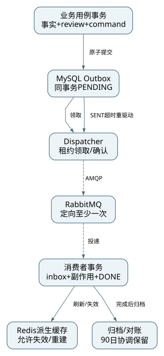

### 4.4 缓存与防护

表4-4 Redis Key设计（来源：自绘）

| Key | 粒度/内容 | TTL | 更新/失效 |
|---|---|---|---|
| sg:feed:{mode}:{category}:{bucket} | 公共候选ID和分数，不含私有正文 | 60±15秒 | 内容事件删；读时实时状态过滤 |
| sg:rec:{userId}:{snapshotId} | 最多300个排序候选ID/解释/偏好版本 | 120秒 | 偏好/隐藏/关注修改后全部失效 |
| sg:note:{id}:metric | 可重建展示计数 | 30±5秒 | 统计消费者刷新；定期对账 |
| sg:topic:active | 有效话题配置 | 300±60秒 | 管理更新事件删除；发布时回DB校验 |
| sg:dash:{scope}:{id}:{days} | 聚合图表结果与calculatedAt | 60秒 | 日聚合后删除；公开越权不靠Key判断 |
| sg:limit:{actor}:{window} | Lua原子限流计数 | 对应窗口+1秒 | Redis故障改本机更严格限流 |

Redis采用allkeys-lfu，全部key可丢；no AOF、无唯一业务事实。穿透：格式校验、批量查存在性、无效公共ID短空值10秒；不缓存越权结果到共用key。击穿：每实例singleflight、有界等待100ms、互斥重建；跨实例可选短租锁但不用于正确性。雪崩：TTL抖动、预热热门、bulkhead和降级限额。重建重复只影响性能不破坏数据。缓存写入失败记录日志，不回滚已提交业务。

### 4.5 索引、查询与容量

列表按published_at/id降序；作者列表按author_id/status/id；互动唯一关系user_id/note_id，反向统计有note_id索引。Outbox使用status/available_at/id领取；通知recipient_id/read_at/id查询。禁止用户提供任意ORDER BY字符串，排序字段白名单。

中文标题/正文检索优先建立ngram全文索引，最新排序用二级索引；短词或作者名采用限额LIKE备选，所有LIKE参数转义并绑定，禁止拼接原始SQL。`schema.sql`基础结构不自动创建全文索引，实施T05迁移单独添加并记录中文召回/EXPLAIN验证；无法达成时按ADR重评，不能宣称已完成搜索优化。

推荐规则固定为：score=40×兴趣话题命中(0/1)+30×已关注作者(0/1)+20×热度归一化(0..1)+10×新鲜度(0..1)，降权话题命中时整体乘0.1；隐藏笔记与不可见内容直接排除。热度=log(1+点赞+2×去重收藏人数+评论)，以候选集最大值归一化；新鲜度=max(0,1−发布后小时数/168)。解释优先级为INTEREST→FOLLOWING→POPULAR，最新流为LATEST，只有条件实际命中才使用相应解释。每次生成快照只取最近7日最多300候选，按score/id降序；不足则按最新公开内容补充并标明热门/最新兜底。无符合“减少话题”内容可替代时不保证占比严格降低，界面提示候选不足；有足够替代测试集必须降低。

快照固定排序和snapshotId、queryHash、viewerId、偏好版本，游标HMAC签名并携带offset；分页后实时批量过滤可见性/隐藏，不重算原分数。偏好/隐藏/关注改变使快照无效，旧游标409 FEED_REFRESH_REQUIRED；Redis故障则推荐入口明确降级为按published_at/id的最新流，使用mode=latest的独立游标。搜索热度/相关度排序也建立120秒候选快照，最新排序用keyset；缓存缺失不得直接用offset翻实时重排数据。

设计数据量：1万篇×平均结构化8KiB≈78MiB；索引按2倍预留约234MiB；日增媒体600MB，30日18GB；一年约219GB，因此本地60GiB仅适合短期课程样本，不是全年容量。备份需至少额外一份媒体和DB空间，另备外接/其他磁盘。事件按日变更2万×3消费者×约1KiB×90日≈5.4GB（未计索引），应按真实收件消费者数与JSON大小校正。

### 4.6 隐私、备份与生命周期

密码BCrypt，cost=12起步并测登录耗时；密码UTF-8≤72字节；令牌256bit安全随机、只存SHA256；Cookie不进日志。原则上不采集手机号/身份证/位置；媒体重编码去EXIF。备份使用加密归档、密钥独立保存；主机卷加密由操作系统能力落实，不能仅写“数据库已加密”而未启用。

每日北京时间02:00 DB一致性逻辑备份+媒体目录备份，备份窗口暂停上传与写操作以取得跨DB/文件一致快照；保留7个日备份和4个周备份，另拷一份到不同介质。恢复顺序：校验备份哈希→空卷恢复媒体→恢复DB→迁移校验→权限/内容/媒体/消息抽验。测试时实际计时，目标RPO24h/RTO2h。单机同盘备份不防磁盘丢失，不能宣称已满足灾难恢复。

审计保留180日，业务事件与Inbox保留90日且清理必须同批协调；仅清理DONE事件，PENDING/SENT/DEAD不能自动过期。若重放超出保留期，先离线对账重建，不直接重复增量消费。command保留7日；匿名访问去重窗口记录7日后清理，累计浏览另持久化。删除笔记保留最小治理信息，媒体等待引用和保留期检查后清理；已经进入浏览器的内容无法撤回，保证的是后续服务请求不再提供。

## 5 开发架构视图

### 5.1 技术版本与依赖

表5-1 设计版本基线（来源：官方资料[R1]–[R12]与本项目选择）

| 技术 | 设计版本 | 理由/被否决备选 | 许可证 |
|---|---|---|---|
| JDK | 21，Temurin发行版补丁由构建前锁定digest | 用户固定；不改Java25，不用预览特性 | GPLv2+Classpath Exception |
| Spring Boot | 3.5.16 BOM | Java21兼容，3系生态；4系首期迁移面大 | Apache-2.0 |
| MyBatis-Plus | 3.5.18 Boot3 starter | 用户固定；对比JPA更符合指定SQL控制 | Apache-2.0 |
| MySQL | 8.4.13 | LTS系列；不为作业引入其他关系库 | GPLv2（Community） |
| Redis | 8.2.11 | 已核实补丁；不把8系许可证标作BSD | 该版本为RSALv2/SSPLv1/AGPLv3三选一，项目制品记录选择及保留原许可[R14] |
| RabbitMQ | 4.4.0-management | 当前官方发行记录可核验；AMQP0-9-1 | MPL-2.0 |
| Vue | 3.5.40 | 用户确认Vue3；React不并行维护 | MIT |
| TypeScript | 5.9.3 | 显式类型契约，避免any泛滥 | Apache-2.0 |
| Vite | 8.0.0作为已核实主版本基点 | 构建轻量；实施前检查同主版本安全补丁并更新ADR/lock | MIT |
| Node | 24.22.2 | 官方发行记录；用于前端构建，不参与后端服务 | MIT及所附第三方声明 |
| Maven | 3.9.16 Wrapper | 官方仍维护的3.9线；比Gradle减少个人维护选择 | Apache-2.0 |

Spring Security6.5.11、Session3.5.7、JDBC驱动、AMQP客户端、Actuator、Micrometer、Jackson、JUnit、Mockito、Testcontainers由Boot3.5.16 BOM管理，不单独覆盖。前端辅助库和监控镜像的确切补丁在T01依赖解析时锁定，不编造未核实版本；固定文件`dependency-lock.md`记录所有直接依赖与许可证，npm提交package-lock，容器提交digest清单。当前版本表是设计基线，不是已通过构建的组合，不宣称无已知漏洞。

前端本期不强制引入商业组件库；Vue Router4、Pinia3、ECharts6、Vitest与Playwright按兼容范围解析并记录确切版本后才允许进入业务实现。Nginx稳定版、Prometheus、Grafana亦按T01锁定。风险扫描发现高危时先修复或记录可验证豁免，不能为了固定本文版本忽略安全更新。

### 5.2 源码结构与映射

```text
03-源码/
  backend/
    pom.xml / mvnw / mvnw.cmd
    src/main/java/cn/shiguang/notes/
      NotesApplication.java
      web/{identity,content,discovery,social,collection,notification,governance,statistics}/
      workflows/{identity,content,discovery,social,collection,notification,governance,statistics}/
      modules/{identity,content,discovery,social,collection,notification,governance,statistics}/
        api/ application/ domain/ infrastructure/
      shared/{contract,error,time}/
      platform/{application,persistence,messaging,security,readmodel,storage,config}/
    src/main/resources/{application.yml,application-dev.yml,application-test.yml,application-prod.yml}
    src/main/resources/db/migration/V1__initial_schema.sql
    src/test/java/cn/shiguang/notes/{architecture,unit,integration}/
  frontend/
    src/{app,router,api,components,features,styles}/
    src/features/{identity,content,discovery,social,collection,notification,governance,statistics}/
    tests/e2e/
  deploy/{nginx,monitoring,backup}/
  scripts/{check-contracts.py,check-layering.py}/
  docs/api/openapi.yaml
  docker-compose.yml / .env.example / README.md
```

这是规划路径，当前未创建业务工程。web只负责HTTP，workflows负责编排/事务，modules内实现对应业务，platform集成技术，shared仅稳定技术契约。MyBatis PO/Mapper/XML只在infrastructure或platform persistence/readmodel，禁止把BaseMapper作为业务API返回给Controller。

图5-1 编译模块依赖（来源：自绘）

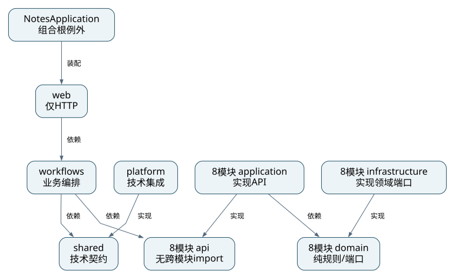

采用一个Maven工程、包级模块边界，便于个人维护；不以8个微服务pom伪装模块化。图中的节点为编译包边界不是独立进程。

### 5.3 前端页面与状态

表5-2 页面与契约（来源：自绘）

| 路由 | 内容 | 交互/鉴权 |
|---|---|---|
| /、/following、/search | 瀑布流、关注、查询 | 关注/个性化需登录；请求游标绑定筛选 |
| /notes/:id | 公开详情、评论、点赞收藏、反馈 | 目标失效统一提示；写操作不乐观伪造成功 |
| /login、/register、/me | 认证与资料 | HttpOnly Cookie不可由JS读取；CSRF在内存管理 |
| /creator、/editor/:id | 本人草稿、发布状态、编辑 | 离开未保存提示；409提供重新加载，不静默覆盖 |
| /collections、/practices/:id | 私有收藏夹与实践时间线 | 结果默认私有；申请公开明确说明审核 |
| /notifications、/preferences | 分类通知与兴趣管理 | 刷新后保持；退出清理前端个人状态 |
| /dashboard | 创作者7/30日图表 | 单位、范围、水位/暂无数据 |
| /admin/reviews、/admin/reports | 审核/举报 | REVIEWER路由守卫+后端权限，不得自审 |
| /admin/users、/admin/topics、/admin/statistics | 管理与平台统计 | ADMIN独立权限；审计入口按角色 |

Pinia只存当前公开可用身份摘要、UI状态和临时CSRF；不把密码/会话令牌持久化到localStorage。数据请求集中在api，按OpenAPI生成类型或校验手写类型；页面不直接拼接后端DTO。表单提供loading/空态/失败/重试，鼠标和键盘均可完成。

### 5.4 配置、环境与密钥

表5-3 环境规划（来源：自绘）

| 环境 | 用途 | 数据/隔离 | 配置 |
|---|---|---|---|
| dev | 个人IDE热更新 | 独立sg_dev库/本地卷/测试账号 | 本机环境变量、示例配置无真密钥 |
| test | CI与集成测试 | Testcontainers临时实例，种子可重复 | CI secret，生命周期结束清理 |
| staging | 本地完整演示演练 | 独立Compose project名和卷 | 镜像制品、验收账号，禁止复用dev库 |
| prod-demo | 将来云演示 | 脱敏/合成数据、云安全组 | HTTPS+Secure Cookie；尚未部署 |

配置项包含DB_URL/USER/PASSWORD、REDIS_HOST/PASSWORD、RABBIT_HOST/USER/PASSWORD/VHOST、MEDIA_ROOT、SESSION_TTL、CURSOR_HMAC_KEY、AUDIT_RETENTION_DAYS。`.env.example`只列名称/非敏感示例，真实.env加入gitignore；数据库迁移账户与业务账户分离。审计表业务账户仅INSERT/SELECT，迁移账号不能被Web使用。

### 5.5 构建、CI与门禁

图5-2 构建发布流水线（来源：自绘）

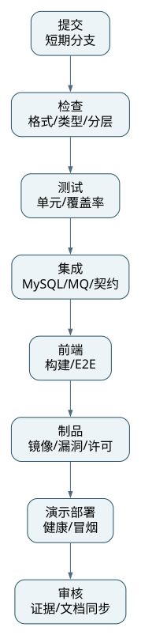

提交触发：格式/类型/分层检查→单测/覆盖率→MySQL+Rabbit集成→OpenAPI响应契约→前端构建/E2E→镜像/漏洞/许可证清单→演示环境部署→冒烟/人工审核。任一失败阻断后续；云发布需用户另行授权，本轮只设计。

命名：类大驼峰、方法小驼峰、常量全大写、表snake_case；异常统一BizException+错误码，业务错误不可吞掉；Slf4j分级和traceId，禁System.out/裸printStackTrace；公开API及领域规则有Javadoc；事务只在指定用例入口。实体不直接返回JSON，DTO显式映射。

分支建议main保持可运行，短期feature分支；个人也做差异自审；Conventional Commits+SemVer。至少25次有意义提交覆盖6周是课程证据要求，实际截止未知，不能计划一天伪造历史。提交业务切片而非机械拆commit。

测试分布目标单元70%、集成20%、E2E10%（按用例数量指导而非课程硬比）；重点是状态、授权、并发和失败路径。Mock仅外部技术端口；事务、唯一键、锁、实际SQL和MQ确认用真实容器测试，不以H2代替MySQL验证。至少10个核心单测，完整测试表见开发计划。

### 5.6 AI辅助与Skill规范

三项必交Skill为project-scaffold、module-generator、arch-doc-sync，每项frontmatter与正文七要素齐全，至少一个可执行资产；可选测试/部署Skill在核心完成后增加。约束必须逐字对应DEP-01–07和本章编码规范。初始化生成规划目录和配置；模块生成不能跨模块import；同步Skill扫描事实并报告差异，不能替用户把计划路径标为真实代码。

本轮仅完成Skill开发方案，不声称已交付完整可用Skill包，也不虚构≥5次使用证据。实施任务T01/T12负责生成和真实使用记录。AI可辅助草稿、图表、代码、测试，但架构决策与修正需本人理解；AI使用说明保留至少3个真实前后对比。

## 6 运行架构视图

### 6.1 进程、线程与连接池

表6-1 运行实体设计（来源：自绘）

| 实体 | 实例/线程 | 端口/协议 | 设计资源上限 |
|---|---|---|---|
| Nginx | 1进程组 | 宿主127.0.0.1:8080→80 HTTP | 128MiB |
| Java应用 | 1JVM | 内网8080 HTTP；8081管理端口 | 1536MiB，Xmx768MiB |
| HTTP线程池 | 最大64、最小8 | MVC阻塞请求 | 入队与超时有界 |
| HikariCP | max16/min4 | JDBC3306 | 连接等待1秒，事务目标<500ms |
| Redis | 1实例 | 内网6379 RESP | 容器384MiB；maxmemory256MiB |
| RabbitMQ | 1节点 | 5672 AMQP；15672仅loopback调试 | 768MiB |
| MySQL | 1实例 | 3306内网 | 1536MiB；buffer pool512MiB起 |
| 消费者 | 3类，各1–2消费者 | Rabbit，prefetch20 | 共享JVM，不另画微服务 |
| Outbox任务 | 1调度线程+2发布线程 | 每1秒领取最多100条 | 网络发布不占DB事务 |
| 统计/清理任务 | 1调度线程；互斥任务租约 | 日/小时/分钟 | 长任务分批1000，不持长锁 |
| Prometheus/Grafana | 可选，各1实例 | 内网9090/3000；宿主loopback | 合计建议768MiB |

文件解码和I/O会阻塞，使用独立最大4线程图像处理池、队列16；超出返回429，拒绝无限排队。上传网络/图像处理不放数据库事务。请求线程不等待消息消费；JDBC、Redis和AMQP配置明确超时，不把虚拟线程视为自动增加DB容量。Java21本期不启用虚拟线程，避免连接池与阻塞任务的容量误解。

### 6.2 三个运行场景（与L7不重复）

图6-1 并发点赞与唯一事实（来源：自绘）

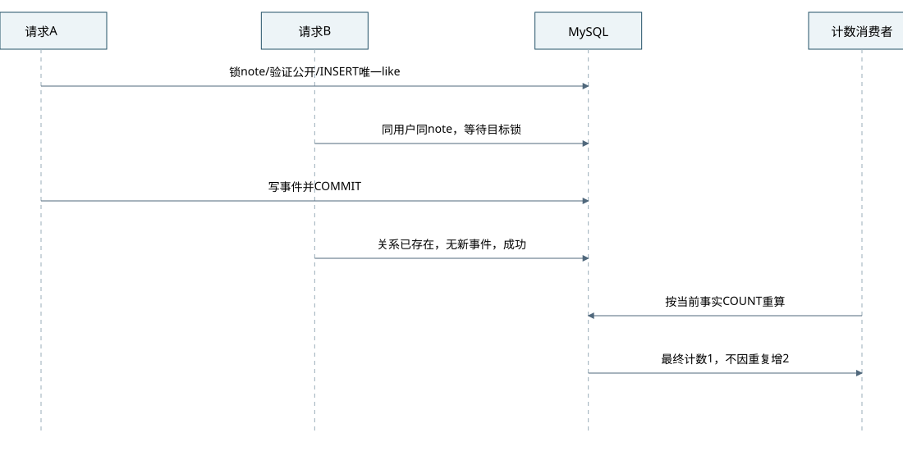

两个相同用户请求先锁同一目标并检查可见性，INSERT唯一关系。仅真正插入的事务写业务事件；已存在直接成功。取消仅在实际删除时发取消事件，计数消费者按关系事实重算，不按重复消息递增。

图6-2 消费提交后ACK前崩溃（来源：自绘）

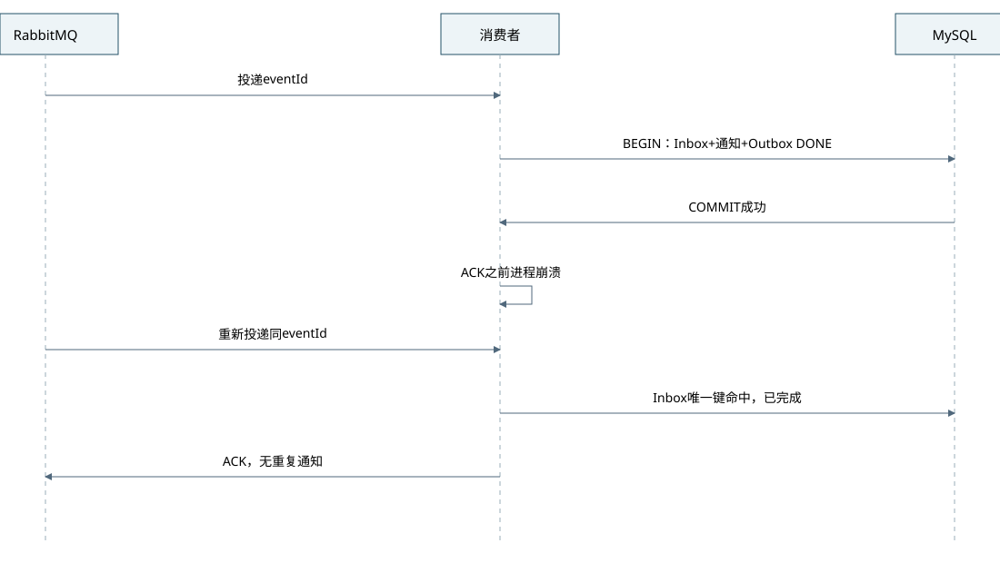

消费者在本地事务插入Inbox、写通知或重算统计、将对应Outbox置DONE，然后提交再ACK。提交后崩溃会重投；Inbox唯一键命中后验证已完成，ACK即可。Inbox不与业务分开提交，否则会产生已去重但业务丢失。

图6-3 Redis故障与有界降级（来源：自绘）

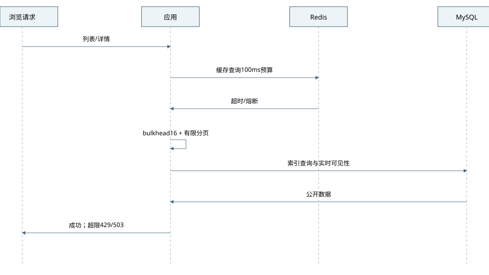

Redis超时不触发无穷重试；熔断后公共查询使用主库索引、较小size和本地bulkhead，达到上限429/503。身份、归属、可见性继续查主库。偏好和隐藏ID持久化在MySQL，不能以Redis故障为由返回用户已隐藏内容。

### 6.3 核心对象状态机

图6-4 笔记状态机（来源：自绘）

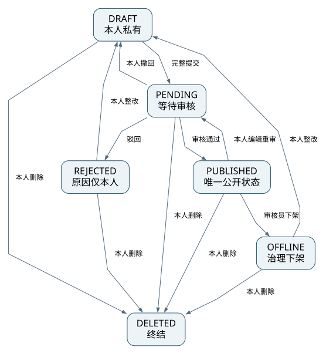

表6-2 合法迁移（来源：需求稿）

| 当前 | 下一状态 | 条件/副作用 |
|---|---|---|
| DRAFT | PENDING / DELETED | 本人提交完整内容或删除；提交同revision唯一review |
| PENDING | PUBLISHED / REJECTED / DRAFT / DELETED | 审核通过/驳回或作者撤回/删除；任务同步终结/取消 |
| PUBLISHED | PENDING / OFFLINE / DELETED | 作者编辑自动提交重审；审核员下架；本人删除 |
| REJECTED / OFFLINE | DRAFT / DELETED | 本人整改保存或删除；不得直接恢复公开 |
| DELETED | 无 | 终结；本期不恢复 |

首次草稿revision=1，保存编辑和每次新的审核提交都递增revision，任何变更递增version。revision表示审核快照编号，而不只是正文编辑次数；撤回后不编辑再次提交也必须产生新revision，禁止复活CANCELLED任务或返回旧任务作为新提交。PUBLISHED编辑后必须仍满足完整发布条件并在同一事务改PENDING、取消旧review、创建新revision审核；正文旧版本不公开。PENDING不能直接改内容，先撤回为DRAFT。审阅预览绑定revision，不从公共接口绕读。

实践状态PLANNED→DOING或ABANDONED；DOING→DONE或ABANDONED；DONE/ABANDONED终结，本期不重开。DONE可编辑自己的结果但每次递增feedback_revision并改PRIVATE、取消未决审核；每次新申请公开也递增feedback_revision，因此撤回后原样重提不会复用已取消审核。公开状态PRIVATE/REJECTED/OFFLINE→PENDING→PUBLISHED或REJECTED，主动撤回回PRIVATE。源note必须PUBLISHED且revision等于source_revision才可公开，因此源编辑/下架后即使异步失效尚未处理也不泄露。原笔记重新发布也不自动恢复旧反馈。

### 6.4 可靠消息与补偿

固定topic交换机`sg.events`，每消费者独立durable classic队列：`sg.notification.q`、`sg.statistics.q`、`sg.cache.q`，routing key为`{eventType}.{consumer}`。本地单节点使用持久classic队列，不宣称高可用；云三节点后可评估quorum。定向Outbox每eventId+consumer一行，支持独立补发，不因一个消费者失败重发已完成消费者的副作用。

表6-3 事件订阅（来源：自绘）

| 事件 | 生产用例 | 消费者 |
|---|---|---|
| NoteSubmitted/ReviewDecided/NoteVisibilityChanged | 发布/审核/下架/删除 | notification按需、statistics、cache |
| LikeChanged/CommentCreated/CommentVisibilityChanged/FollowChanged | 社区用例 | notification仅新增且非自行为、statistics、cache |
| FavoriteChanged/PracticeChanged/FeedbackVisibilityChanged | 收藏实践用例 | statistics、cache |
| ReportDecided/UserStatusChanged | 治理身份用例 | notification、statistics按需 |

投递算法：业务提交PENDING→调度短事务`FOR UPDATE SKIP LOCKED`领取并设置LEASED/lease_until=30s→事务外以persistent消息+mandatory+publisher confirm发布→ACK且未basic.return则置SENT；失败回PENDING并退避。租约过期可重新领取，eventId不变。发布线程绝不持DB锁等待网络。

SENT不等于消费完成：超过60秒仍非DONE，查Inbox，无记录则重新投递；这使单机broker在确认后丢盘时仍能从数据库重建未完成投递。消息至少一次，不承诺跨MySQL与Rabbit的原子exactly once。消费通过唯一Inbox实现业务副作用幂等。

并发状态更新全部使用CAS：领取生成lease_token；发布成功仅能在状态LEASED且token匹配时置SENT，失败回PENDING同样校验token。DONE是不可被发布回调、重试副本或租约过期扫描覆盖的终态；Inbox成功记录优先于任何重试安排。消费若快于confirm回调，先完成置DONE后，迟到回调更新0行视为已被消费，不改回SENT。失败记录事务也必须先检查Inbox和DONE；旧副本不得把已完成事件写回PENDING/DEAD。T02用屏障确定性复现这些竞态。

消费者入口先锁对应Outbox行并检查Inbox；已完成直接ACK。未完成只允许消息AMQP头携带的lease_token与当前值一致且状态为LEASED/SENT时进入业务事务；旧token、PENDING等待和DEAD副本不得再执行业务。失败安排短事务提交时清空当前token并设置available_at，故即使提交后ACK前崩溃，原消息重投也只会被识别为旧副本并ACK，不能绕过退避或重复累计attempts。PENDING到期由调度器生成新token重发；DEAD入口只处理脱敏DLQ交付确认，不重做业务。若失败安排事务本身未提交，则不ACK，原token仍可在重投时处理。T02必须覆盖这一明确崩溃窗口。

业务异常重试采用数据库调度，延迟5/30/120秒、最多5次；消费者失败回滚业务，再短事务记录下一次available_at和错误后ACK原消息，若记录失败不ACK并断开交由重投。超过阈值Outbox=DEAD，保留告警与人工重放；同时将脱敏诊断投递到`sg.dlq`，只有confirm后ACK原消息。即使DLQ不可用，DEAD事实仍保留在DB，不静默丢弃；不使用无限nack(requeue=true)热循环。

这里的5次上限针对不可处理的业务消费异常；Broker连接/确认失败属于投递异常，保持PENDING，指数退避上限30秒直至恢复或积压保护触发，不能因短时MQ中断将所有消息转死信。重复旧投递的失败安排同样遵守CAS与Inbox优先规则。

人工重放须ADMIN、原因、审计，保持eventId且仅处理未完成consumer。积压未完成Outbox>100000或最老>15分钟时，产生事件的写用例返回503并回滚，避免无限填满磁盘；读操作保留。有计划停止测试故障后，先恢复消费者再恢复写负载。

### 6.4.1 浏览、活跃与统计生产链路

公开详情完成主库授权后，在短事务向t_view_window插入(用户或匿名会话HMAC、noteId、30分钟窗口起点)；只有首次插入成功才同事务追加NoteViewed事件，失败回滚，不通过反复请求制造新浏览。响应可标记浏览统计稍后更新，不因非关键计数失败泄露内部异常。事件包含occurredAt、noteId、authorId和去重窗口，不含IP/正文；订阅statistics。消费者Inbox去重后按业务时间对应北京日对NOTE/AUTHOR/PLATFORM的VIEW增量作唯一一次更新，并重算note_metric.view_count为持久化NOTE日VIEW之和。7日后清理view_window不影响长期日汇总；90日后清理完成事件也不删除日汇总。

登录账号成功完成任一有效业务查询或写操作后，过滤器记录t_daily_activity(day,user_id)唯一事实；失败请求、健康检查和纯轮询通知不算活跃。可用短缓存减少重复INSERT，但必须DB成功后才设缓存，Redis丢失只会产生幂等INSERT，不丢DAU。每日活跃从该表COUNT DISTINCT，不从已过期会话反推。该写失败只影响指标并告警，不改变已成功业务响应，统计报告须注明此类采集缺失。

表6-5 指标代码与事实来源（来源：本项目设计）

| 代码 | 定义/来源 | 时间与更新 |
|---|---|---|
| VIEW | 去重NoteViewed，每条只消费一次；按NOTE/AUTHOR/PLATFORM汇总 | occurredAt对应北京日；实时聚合与90日事件对账 |
| DAU | t_daily_activity同日登录用户数 | day；每日/查询时聚合 |
| NOTE_PUBLISHED | 当日首次/再次通过的发布动作数，界面标“发布次数”而非唯一笔记数 | ReviewDecided中decision/targetType，occurredAt |
| LIKE_ADD / LIKE_REMOVE | 当日真实关系变化动作次数 | LikeChanged.desired与occurredAt；同一eventId跨consumer先去重 |
| COMMENT_ADD / FOLLOW_ADD | 当日新增有效动作 | 对应Created/Changed事件；当前可见量另按事实重算 |
| REVIEW_PENDING / REVIEW_DURATION_MS | 当前待审数、已决任务从created_at到decided_at时长 | t_review；时长仅已决任务，未决不纳入均值 |
| REPORT_ACCEPTED / REPORT_CLOSED | 选定受理时间范围工单数/其中已结案数 | t_report.created_at为队列范围，closed_at判结案 |
| PRACTICE_CREATED / PRACTICE_DONE | 同一创建时间队列创建数/其中当前DONE数 | t_practice.created_at；空分母“暂无数据” |

点赞数、收藏人数、可见评论数是当前存量，消费者按当前关系批量重算；日新增/取消是动作流量，不能用当前存量反推历史。统计写入以Inbox去重事务保护，定时任务按最近3个业务日重算迟到事件并保留calculatedAt水位；对Outbox不同consumer副本先按eventId去重。历史日VIEW重算必须覆盖完整日事件保留范围，否则保留已封账日汇总，不能用残缺事件覆盖。每日02:30执行全量/分批关系计数对账和前日封账。

### 6.5 容量计算与瓶颈

峰值QPS=1000DAU×100请求/人÷7200有效秒×5峰值系数≈69.4，设计目标100QPS。平均服务时间按0.1s暂估，Little定律并发≈100×0.1=10；线程池64是有界余量，不是已经测出的容量。数据库连接16需用压测验证等待与SQL耗时。若单实例实测能力为C，则实例数=ceil(峰值QPS/C×1.3)，C未知不能填经验数冒充实测。

若日变更2万、平均2个消费者，每日4万投递，日均0.46条/s；按20倍突发约9.3条/s；故障10分钟约5600条（按突发持续的保守估计）。要求5分钟追平则净处理能力至少18.7条/s，再加正常9.3，消费者需≥28条/s。该估计用于制定故障测试，不是吞吐报告。

主要瓶颈：私有图像代理带宽/解码、模糊检索、带锁热笔记互动、统计跨表聚合、磁盘与备份。优化顺序为图片压缩/缩略、索引与分页、短事务、批量重算、独立媒体服务；不先分库分表。图像代理安全性带来带宽代价，在ADR-009公开说明。

### 6.6 限流、超时、熔断与可观测性

表6-4 容错阈值（来源：自绘，待调优）

| 机制 | 阈值 | 行为 |
|---|---|---|
| 登录 | 账号5次/分钟+IP20次/分钟 | 429、Retry-After；不永久锁定可被攻击的账号 |
| 普通写/上传 | 用户30次/分钟；上传10次/分钟 | 429；管理员操作也有限额 |
| 公共读 | IP120次/分钟起步 | 429；校园共享NAT需按实测调整 |
| Redis | 命令100ms，1秒内5次故障开路10秒 | 最多1次尝试，主库降级 |
| JDBC | 等连接1秒、查询2秒、事务5秒上限 | 503/超时回滚，不吞异常 |
| AMQP | confirm3秒、重连退避最高30秒 | Outbox保留并自动重发 |
| 图像处理 | 4线程、队列16、单任务5秒预算 | 超时丢弃临时文件，拒绝超像素图 |
| DB降级bulkhead | 16并发、等候100ms | 超限503，避免缓存失效放大 |

每个HTTP请求生成traceId，业务事件继承；日志JSON、UTC、等级、actorId脱敏、事件ID/耗时/结果，不记录密码/Cookie/CSRF。指标包含请求QPS/P95/错误、连接池等待、JVM堆、图像队列、Outbox状态/最老年龄、MQ ready/unacked、消费者重试、磁盘容量。关键告警：5xx>5%持续5min；最老未完事件>60s；磁盘可用<20%；DEAD>0立即。单体以traceId串联用例/事件，先不另装分布式追踪存储；未来多服务再接OTLP。

### 6.7 安全运行

使用DB权威会话：登录校验后生成256bit随机令牌，SHA256入t_session，原值只发SG_SESSION HttpOnly Cookie；固定有效24小时，无静默延长。退出设置revoked_at。每个受保护请求查询session+user状态/auth_version，缓存不参与最终授权；DB故障时拒绝，不用旧缓存放行。

Cookie SameSite=Lax、生产Secure、Path=/；同步CSRF令牌写入会话哈希，前端从`/auth/csrf`获取，放X-CSRF-TOKEN。登录前用短期匿名会话，登录后轮换；登录与注册同样防CSRF和暴力尝试。CORS默认同源，生产只精确允许来源，不启用任意凭证域。

写请求允许用户重试，靠幂等键和业务唯一性防重复副作用；不会声称CSRF阻止拥有有效令牌的攻击者重放。HTTPS保护传输；会话窃取通过退出/封禁/过期撤销。SQL全部绑定参数，排序白名单；纯文本输出转义不使用v-html；媒体真实解码，路径不可注入，禁任意URL抓取。安全端点需RBAC+对象权限+状态条件，后台路由前端守卫仅改善体验。

## 7 物理架构视图

### 7.1 当前本地部署与建议云演进

图7-1 本地Compose部署（来源：自绘）

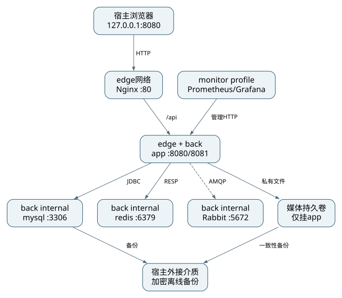

当前没有服务器，只有设计。默认宿主只映射127.0.0.1:8080供浏览器；debug profile可映射MySQL/Redis/MQ管理到loopback，不向局域网暴露。Nginx连接edge网与internal back网；app同时连接两者；DB、Redis、MQ只在back网络。媒体卷仅挂app，不挂Nginx静态目录。

DNS/CDN本地不使用，以localhost访问；TLS本地HTTP仅loopback，云端必须域名HTTPS由Nginx终止。监控抓取管理端口只在back；Grafana可选loopback:3000，管理密码从secret配置。没有WAF部署证据，本地由入口限额/内容类型/安全头承担基础防护，云端如启用WAF须记录规则与成本。

### 7.2 资源与端口矩阵

节点是计划中的本地主机Docker Desktop/WSL2 Linux容器运行环境；建议4vCPU、8GiB给Docker、可用磁盘60GiB以上，OS实际版本由实施T01采集。容器上限见表6-1，总核心内存约4.25GiB，监控后约5GiB，其余预留给内核、文件缓存和构建；不能据此声称2核4G足够完整演示。

表7-1 网络矩阵（来源：自绘）

| 来源 | 目标/端口 | 许可 |
|---|---|---|
| 本机浏览器 | 127.0.0.1:8080 | 允许 |
| Nginx | app:8080 | edge内允许 |
| app | mysql:3306、redis:6379、rabbitmq:5672 | back内允许 |
| Prometheus | app:8081、rabbitmq:15692 | monitor profile内允许 |
| 外部主机 | DB/Redis/MQ/Actuator | 禁止 |
| 本机运维 | 15672/3000等 | 仅显式debug/monitor profile及loopback |

### 7.3 制品与部署契约

后端多阶段JDK21构建、JRE21运行、非root用户、只读根目录和tmpfs；前端Node构建后只把dist放Nginx镜像。MySQL/Redis/Rabbit镜像固定补丁和digest，禁止latest。镜像体积为待测，预算目标后端<300MiB、前端<100MiB但不填假结果。配置用环境或只读secret文件，初始化密码不写入镜像层。

`attachments/compose.design.yaml`为依赖设施和未来应用的设计清单。完整项目实现后迁入03-源码/docker-compose.yml；当前无业务Dockerfile与可运行应用，因此不能声称一键启动已经通过。健康检查后再依序启动app/nginx，app迁移失败应退出，禁止在错误schema上启动。

设计启动流程：复制.env.example并生成本地随机secret→构建镜像→`docker compose config`校验→`docker compose up -d --build`→健康检查→迁移/种子账号→浏览器登录与角色冒烟。Windows PowerShell用mvnw.cmd，Linux用./mvnw；最终README同时提供命令。

### 7.4 高可用、备份与扩缩容

当前单机所有组件均有单点，宿主磁盘故障会导致业务停止；Compose restart只处理进程退出，不构成跨机器高可用。应用从无状态会话令牌+DB权威状态可扩展到2实例，但后台调度必须用数据库租约避免双处理；媒体本地卷在多宿主时需先迁共享存储或对象存储。

表7-2 云演进建议（尚未采购/部署，来源：自绘）

| 组件 | 当前 | 演进/触发 |
|---|---|---|
| 应用 | 1 JVM | CPU>70%持续5分钟且排除DB瓶颈→2实例+负载均衡 |
| MySQL | 单库 | 需要可用性/恢复目标时主备；写后读/安全查询仍主库 |
| Redis | 可丢单缓存 | 容量/故障频率达阈值后Sentinel或托管；故障仍可安全降级 |
| Rabbit | 单节点classic | 高可用需要≥3节点quorum并演练，不采用已移除的镜像classic教程 |
| 媒体 | app专用卷 | 多宿主前迁对象存储；鉴权代理或严格私有访问策略保持 |
| 监控 | 可选本机 | 独立节点/外部告警，避免宿主故障时完全失察 |

数据库和MQ有状态扩容涉及复制、仲裁、磁盘IO与恢复窗口，不能直接像Web增加副本。本期只完成可恢复单机设计，RPO/RTO来自每日跨介质备份，不宣称自动故障转移。

### 7.5 成本与实际部署证据

表7-3 成本模型（来源：本项目估算方法，不是云报价）

| 资源 | 本期数量 | 预算表达式 | 状态 |
|---|---|---|---|
| 已有开发电脑/本地容器 | 1 | 新增云租赁费0；电力/已有硬件成本另计 | 用户未提供设备规格 |
| 备份介质 | 1份独立副本 | 按现有可用介质或采购价 | 未知，需落实 |
| 建议云主机 | 1台4核8GiB起 | C_vm/月 | 未采购，需按地域/计费核价 |
| 系统盘/数据盘/备份 | 按60GiB及增长 | C_disk+C_backup/月 | 未核价 |
| 出网/域名/HTTPS | 按访问流量 | C_egress+C_domain/12 | 无公网目标，未核价 |
| 云总月费 | — | C_vm+C_disk+C_backup+C_egress+C_domain/12 | 未知，不编造金额 |

用户明确先做本地，因此不把虚构云月费填成实际成本。正式课程若坚持云资源数字表，云选型阶段再取具体官方报价和日期，记录预算取舍；本期额外不部署对象存储、搜索、微服务集群以控制本地资源。

P9实际地址、分角色账号、部署命令执行、访问测试、截图与耗时均未产生。在线环境是后续实施交付；若最终仍无公网/校园网，应按任务书提前申请完整本地录屏替代，不能默认豁免。

## 8 五视图一致性追溯

### 8.1 核心需求横向追溯

表8-1 完整核心追溯（来源：自绘；代码和节点为计划位置）

| FR | 逻辑单元 | 数据实体 | 代码模块 | 运行进程 | 部署节点 | ADR |
|---|---|---|---|---|---|---|
| 01 | LoginUseCase | user/session | workflows.identity / modules.identity | Java MVC | app+mysql | 001/005 |
| 03 | ChangeAccountUseCase | user/user_role/audit/outbox | identity+治理编排 | Java MVC | app+mysql | 005/008 |
| 04 | SaveNoteUseCase | note/media/关联 | content | Java MVC | app+mysql+媒体卷 | 003/009 |
| 06 | SubmitNoteUseCase | note/review/command/outbox | workflows.content | Java事务 | app+mysql | 007/010 |
| 07 | Edit/DeleteNote | note/review/practice | content+治理编排 | Java事务 | app+mysql | 009/010 |
| 08 | PublicContentQuery | note/metric/follow | discovery+readmodel | Java查询 | app+mysql+redis | 004/011 |
| 09 | SearchQuery | note/topic/user | discovery+readmodel | Java查询 | app+mysql | 003/011 |
| 10–11 | RecommendQuery | interest/hidden_note/note | discovery | Java+Redis | app+mysql+redis | 011 |
| 12 | LikeUseCase | like/outbox/inbox | social+statistics | MVC+消费者 | app+mysql+MQ | 007/012 |
| 13 | CommentUseCase | comment/outbox | social | MVC+消费者 | app+mysql+MQ | 007/008 |
| 14 | FollowUseCase | follow/outbox | social | MVC+消费者 | app+mysql+MQ | 007/011 |
| 15–16 | FavoriteUseCase | folder/favorite | collection | Java事务 | app+mysql | 003/012 |
| 17 | PracticeTransition | practice/history | collection | Java事务 | app+mysql | 008/010 |
| 18 | PublishFeedback | practice/media/review | collection+治理编排 | MVC+消费者 | app+mysql+媒体卷 | 009/010 |
| 19–20 | ReceiveNotification | notification/inbox/outbox | notification+messaging | AMQP消费者 | app+mysql+MQ | 007 |
| 21 | MarkReadUseCase | notification | notification | Java MVC | app+mysql | 005/008 |
| 22 | DecideReviewUseCase | review/note/practice/audit | governance编排 | Java事务 | app+mysql+MQ | 010 |
| 23 | DecideReportUseCase | report/audit/业务目标 | governance编排 | Java事务 | app+mysql+MQ | 008/010 |
| 24 | Topic/AuditQuery | topic/audit | governance | Java MVC | app+mysql | 003/008 |
| 25–27 | DashboardQuery | daily_metric/note_metric/事件 | statistics+readmodel | 定时聚合+MVC | app+mysql+redis | 012 |

全量FR到接口、测试和开发任务的映射由附件清单自动核对，不能只给10条后遗漏创新。domain中的实体名与数据库映射不同可以显式说明，不能出现实体关系和FK矛盾。

### 8.2 三个必答问题

问题1：哪个视图约束反向修改了另一个视图？本次设计中，在运行链路分析时发现“生产确认后即删Outbox”无法覆盖单机broker确认后持久盘丢失，因此数据设计增加按consumer定向Outbox、SENT/DONE区分和Inbox；运行视图相应增加60秒重驱动。另一方面，媒体可见性要求推翻直接由Nginx提供图片直链的物理部署方案，改为仅app挂载私有卷，并增加实时媒体授权接口。它们是本次真实设计推导，不是虚构故障演练；后续实现发现需另外记录。

问题2：最高属性为安全与业务正确性。逻辑：显式角色/对象/状态权限和版本审核；数据：约束、事务、会话版本、Outbox/Inbox；开发：纯领域与边界门禁、DTO裁剪、契约测试；运行：重投幂等、主库授权、并发锁序；物理：内网隔离、私有媒体卷、密钥分离与备份。

问题3：用户量10倍的最小变化应以实测瓶颈决定。先重算目标约700QPS和媒体约6GB/日：运行视图调整连接池/线程/消费者并做压测；数据视图改索引/预计算、增加缓存容量和归档，必要时读副本；物理视图增加应用实例并先迁媒体存储、升级DB与带宽；开发视图加入多实例任务租约测试与部署参数；逻辑业务边界保持，只有新增独立媒体/搜索容器时更新容器图及ADR。不能仅把所有实例数乘10，也不预先断言必须微服务。

## 9 开发与验收交付状态

### 9.1 本轮完成与执行证据区分

设计已包含五视图、接口/数据契约、ADR和开发计划。所有代码索引为计划路径，当前未实现程序、未执行数据库DDL、未启动Compose、未压测、未生成账号或公网地址。提交自评只能写“设计完成/执行待验证”，不能填虚假功能分或截图。

后续必须补齐：真实源码与10分钟启动；≥10核心单测及完整关键风险测试；OpenAPI实现覆盖≥80%；有效代码量与文档一致性；≥25次、≥6周Git历史；≥3个Skill与≥5次真实使用；AI说明≥3修正案例；≥12截图；5–8分钟1080P有口播视频≤300MB；答辩PDF与在线环境或获批本地替代。

### 9.2 进度与个人责任

个人负责全部模块与视图，不虚构成员分工/互评；实施按开发计划T01–T12顺序推进。实际截止与教学周未知，采用依赖顺序与工作包而非捏造日历。老师第5/7/11周检查点、第15周交付和第16周答辩要求沿用需求稿；需本人核实是否已错过。

### 9.3 文档自检

逻辑L1–L9、数据D1–D8、开发V1–V10、运行R1–R10、物理P1–P9均有对应设计段落；数据字典与DDL同源；关键逻辑时序与运行时序各3张且不同；ADR≥8、追溯≥10。实际代码一致、依赖漏洞、性能容量、成本数字与部署P9只能在实施阶段完成验证，不以文档检查替代。

## 附录 A ADR与附件

ADR-001至012见adr目录，每条含日期/状态/视图、背景、备选、选择与代价、影响和验证/重评条件。数据字典、接口、开发计划为配套正文；正式PDF按构建清单合并。attachments中的SQL、OpenAPI、Compose均为设计资产，不是可运行源码交付。

## 附录 B 图例与建模约定

所有框图有类型标签：Person/Software System/Container/Component；实线箭头=同步请求或编译依赖（由图题区分），虚线=异步事件，圆柱/数据库标签=持久化存储。时序图横轴参与者、纵轴先后；状态图箭头注明触发；ER用1与0..*等标注基数。静态C4表达边界，领域类图/ER/状态是明确说明的辅助图，不混用层级。SVG为矢量输出，配套JSON/Mermaid为可编辑源，由同一模型生成。

## 附录 C 核心代码索引（计划）

| 架构元素 | 计划位置 | 实施验证 |
|---|---|---|
| 分层门禁 | backend/src/test/java/cn/shiguang/notes/architecture/LayeringTest.java | T01 |
| 笔记状态 | modules/content/domain/Note.java | T03 |
| 审核事务 | workflows/governance/DecideReviewUseCase.java | T04 |
| 媒体授权 | workflows/content/ReadMediaUseCase.java | T03/T08 |
| Outbox发布 | platform/application/OutboxDispatcher.java | T02 |
| 消费去重 | platform/messaging/IdempotentConsumer.java | T02 |
| 推荐策略 | modules/discovery/domain/RecommendationPolicy.java | T05 |
| 实践状态 | modules/collection/domain/Practice.java | T08 |
| 统计聚合 | workflows/statistics/AggregateDailyUseCase.java | T10 |

## 附录 D 参考文献

以下均为官方资料，访问日期2026-11-01。R2/R4/R7/R9等版本发布页带2026或2025可核验日期，满足近三年资料来源要求；访问日期不作为出版年份。课程最终引用仍需本人核查学校参考文献格式。

[R1] Spring. Spring Boot 3.5 System Requirements. [官方文档](https://docs.spring.io/spring-boot/3.5/system-requirements.html).

[R2] MyBatis-Plus团队. 安装与Boot3 Starter. 版本3.5.18. [官方文档](https://baomidou.com/getting-started/install/).

[R3] Oracle. MySQL 8.4 Reference Manual: Locking Reads. [官方文档](https://dev.mysql.com/doc/refman/8.4/en/innodb-locking-reads.html).

[R4] Oracle. Changes in MySQL 8.4.13. 2026-10-20. [发布记录](https://dev.mysql.com/doc/relnotes/mysql/8.4/en/news-8-4-13.html).

[R5] RabbitMQ. Consumer Acknowledgements and Publisher Confirms. [官方文档](https://www.rabbitmq.com/docs/confirms).

[R6] Redis. Key Eviction. [官方文档](https://redis.io/docs/latest/develop/reference/eviction/).

[R7] RabbitMQ. Release Information: 4.4.0. 2026-10-20. [版本与支持](https://www.rabbitmq.com/release-information).

[R8] Spring. Spring Security 6.5: CSRF. [官方文档](https://docs.spring.io/spring-security/reference/6.5/servlet/exploits/csrf.html).

[R9] Vue.js Team. Vue v3.5.40 Release. 2026. [官方发行页](https://github.com/vuejs/core/releases/tag/v3.5.40).

[R10] OpenAPI Initiative. OpenAPI Specification 3.0.3. 2020. [规范](https://spec.openapis.org/oas/v3.0.3.html).

[R11] Simon Brown. The C4 Model. [官方资料](https://c4model.com/).

[R12] Redis. Redis 8.2.11 Release. 2026-10-26. [官方发行列表](https://github.com/redis/redis/releases).

[R13] Spring. Managed Dependency Coordinates, Boot3.5.16. [BOM](https://docs.spring.io/spring-boot/3.5/appendix/dependency-versions/coordinates.html).

[R14] Redis. Licenses. [官方许可说明](https://redis.io/legal/licenses/).

[R15] Vite Team. Vite 8.0.0. [官方发行页](https://github.com/vitejs/vite/releases/tag/v8.0.0).
