# 《XX 系统》架构设计说明书（五视图法）

> **使用说明**：本文件为模板。凡 `【…】` 与 `<!-- … -->` 处均为填写提示，**定稿前请全部删除**。
> 灰色代码块为 Mermaid 图，可直接粘贴到 [mermaid.live](https://mermaid.live) 或支持 Mermaid 的编辑器中渲染，也可改用 draw.io / PlantUML 出图（须保留可编辑源文件）。
> 建议篇幅 40–70 页（不含代码附录）。

---

## 封面信息

| 项目 | 内容 |
|------|------|
| 系统名称 | |
| 版本 | V1.0 |
| 组队形式 | □ 个人　□ 2 人　□ 3 人 |
| 学号 / 姓名 | |
| 完成日期 | |
| 在线访问地址 | |
| 测试账号 | 角色 / 账号 / 密码 |
| 源码仓库 | |

**修订记录**

| 版本 | 日期 | 修订人 | 修订内容 |
|------|------|--------|---------|
| V0.1 | | | 初稿 |
| V1.0 | | | 定稿 |

<!-- 提示：修订记录至少 3 个版本，能体现设计的演进过程，是过程性评价的证据。 -->

---

## 1 需求概述

### 1.1 项目背景与目标

<!-- 3–5 段。说明：为谁解决什么问题、现有方案为何不够、本系统的边界（做什么、不做什么）。 -->

【填写背景：______】

**系统目标**

1. 【目标 1，须可验证，如"预约创建接口 P95 响应时间 ≤ 300ms"】
2. 【目标 2】
3. 【目标 3】

**系统边界（不做的事）**

- 不做【______】
- 不做【______】

### 1.2 用户角色

| 角色 | 描述 | 核心诉求 | 关键权限差异 |
|------|------|---------|-------------|
| | | | |

<!-- 至少 2 类角色（个人）/ 3 类（小组）。必须体现数据可见性差异，不只是菜单差异。 -->

### 1.3 功能需求清单

| 需求 ID | 一级模块 | 子功能 | 优先级 | 涉及角色 | 复杂度类别 |
|---------|---------|--------|-------|---------|-----------|
| FR-01 | | | 高/中/低 | | C1/C2/C3/C4 |

<!-- 至少 6 个一级模块，每模块 ≥3 个子功能。复杂度类别对应任务书 2.3 节的 C1–C4，每条需求至少标注一项。 -->

**功能模块树**

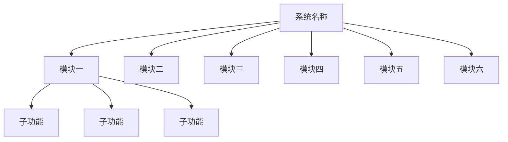

### 1.4 非功能需求（质量属性场景）

采用「刺激—响应—度量」三段式描述，**必须可度量**，禁止写"性能好、易扩展"。

| ID | 质量属性 | 场景描述 | 度量指标 | 目标值 |
|----|---------|---------|---------|-------|
| NFR-01 | 性能 | 在正常负载下，用户提交【XX】请求 | 响应时间 P95 | ≤ 500ms |
| NFR-02 | 可用性 | 系统任意单节点故障 | 服务可用性 | ≥ 99.5% |
| NFR-03 | 可扩展性 | 新增一个业务模块 | 需改动的文件数 | ≤ 5 个 |
| NFR-04 | 安全性 | 未登录访问受保护接口 | 拦截率 | 100% |
| NFR-05 | 可维护性 | 定位一次线上故障 | 平均修复时间 MTTR | ≤ 30min |

**质量属性优先级排序**（Utility Tree 裁剪，最多选 3 个为最高优先级）：

1. 【______】——理由：【______】
2. 【______】——理由：【______】

<!-- 这个排序将贯穿五个视图：你在每个视图里做的取舍，都要能追溯到这里的优先级。 -->

### 1.5 约束与假设

| 类型 | 内容 |
|------|------|
| 技术约束 | 如：团队仅熟悉 Java、必须使用学校服务器 |
| 资源约束 | 如：服务器 2 核 4G × 2 台、无公网 IP |
| 时间约束 | 14 周，课余时间 |
| 合规约束 | 如：个人信息需脱敏存储 |
| 假设 | 如：日活不超过 5000、不考虑国际化 |

---

## 2 架构总览

### 2.1 架构目标与策略

| 最高优先级质量属性 | 采用的架构策略 | 体现在哪些视图 |
|------------------|--------------|--------------|
| | | 逻辑 / 数据 / 开发 / 运行 / 物理 |

### 2.2 架构风格选择

**选定风格**：【分层架构 / 微服务 / 事件驱动 / CQRS / 管道-过滤器 / 微内核 …】

**适用性论证**：

| 候选风格 | 优点（针对本项目） | 缺点 | 是否采用 |
|---------|-----------------|------|---------|
| 【风格 A】 | | |  |
| 【风格 B】 | | |  |

<!-- 必须说明"为什么不用更简单的"和"为什么不用更复杂的"。选择微服务就要回答：你的规模真的需要吗？ -->

### 2.3 系统上下文图

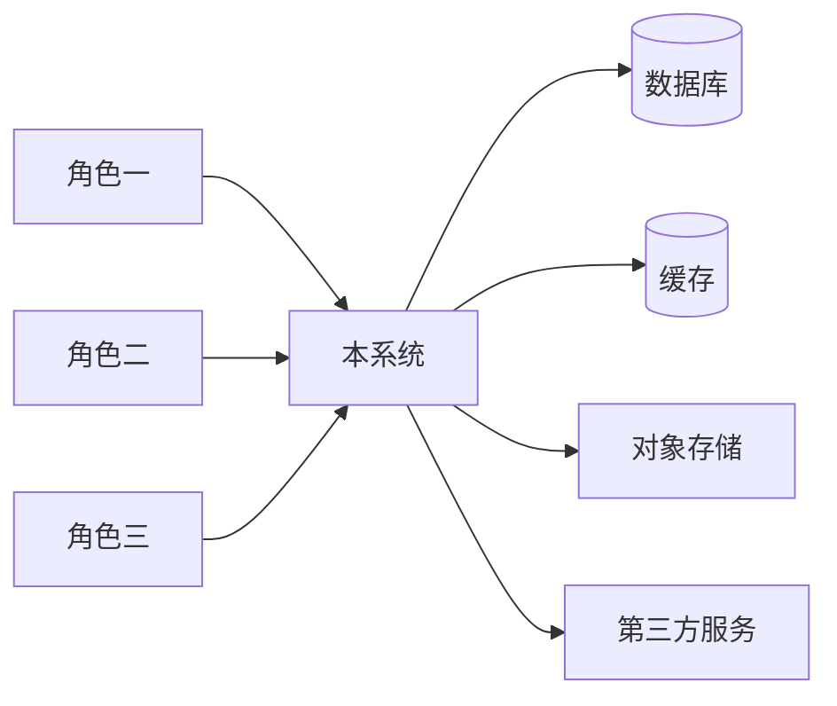

**外部系统清单**

| 外部系统 | 交互方式 | 数据流向 | 失败时的降级策略 |
|---------|---------|---------|----------------|
| | | | |

### 2.4 架构决策记录（ADR）汇总

| ADR 编号 | 决策主题 | 状态 | 涉及视图 |
|---------|---------|------|---------|
| ADR-001 | 后端框架选型 | 已接受 | 开发 |
| ADR-002 | 数据持久层与缓存策略 | 已接受 | 数据 / 运行 |
| ADR-003 | | | |

<!-- ≥8 条，明细放附录 A。至少覆盖：后端框架、前端框架、数据存储、缓存策略、认证授权、部署形态、异步机制、模块划分方式。 -->

---

## 3 逻辑架构视图（Logical View）

> **关注点**：系统为终端用户提供什么功能？如何划分为职责内聚的单元？单元之间如何协作？

### 3.1 功能结构图

<!-- 与 1.3 节模块树一致，此处展开到子功能，并标注重点实现模块。 -->

### 3.2 容器 / 子系统划分（C4-Container）

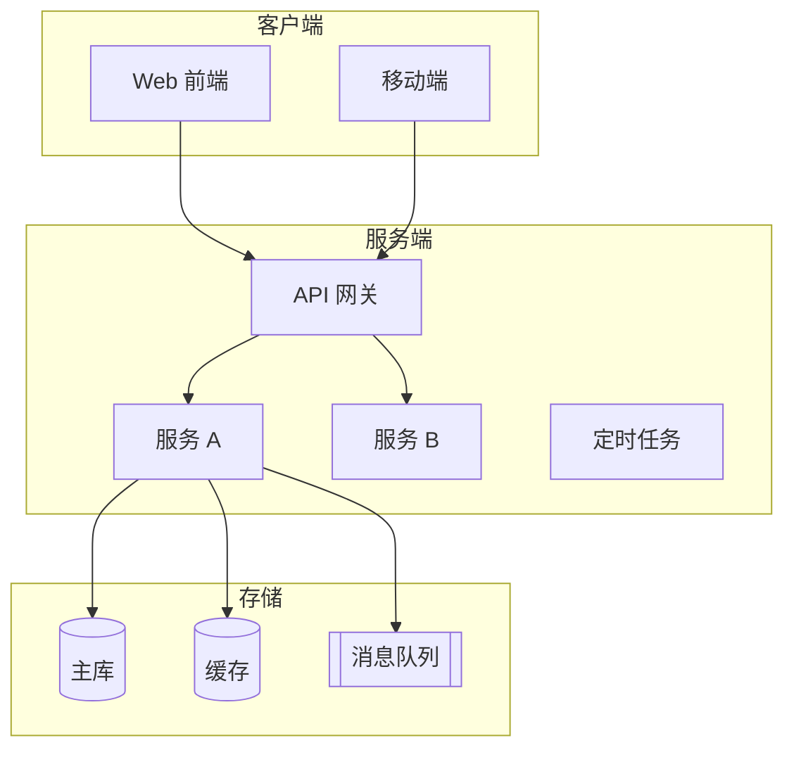

**容器清单**

| 容器 | 职责 | 技术选型 | 通信协议 |
|------|------|---------|---------|
| | | | |

### 3.3 分层架构与依赖规则

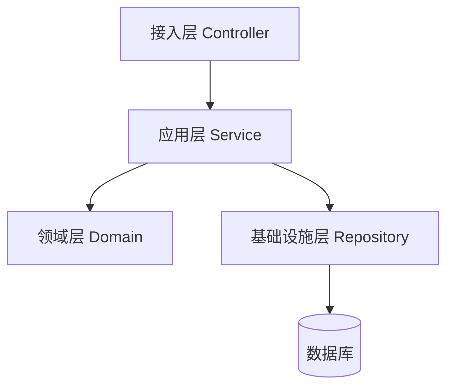

**依赖规则（必须写明禁止项）**

| 规则 ID | 内容 | 检查方式 |
|---------|------|---------|
| R-01 | 禁止 Controller 直接调用 Repository | 脚本 / 人工 Review |
| R-02 | 禁止领域层依赖 Web 框架注解 | |
| R-03 | 禁止同层之间横向调用 | |

<!-- 这几条规则后面要写进你的 Skill（见第 5 章 V10），让 AI 生成代码时自动遵守。 -->

### 3.4 领域模型 / 核心类图

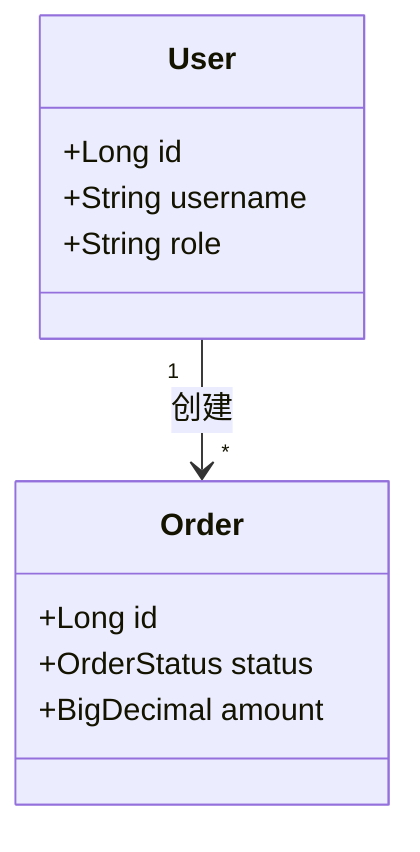

**核心实体说明**（≥8 个）

| 实体 | 含义 | 关键属性 | 与其他实体的关系 |
|------|------|---------|----------------|
| | | | |

### 3.5 关键接口定义（≥5 个）

| 接口 ID | 接口名 | 签名 | 前置条件 | 后置条件 | 异常约定 |
|---------|-------|------|---------|---------|---------|
| IF-01 | | | | | |

### 3.6 关键场景时序图（≥3 个）

**场景 1：【跨模块场景】**

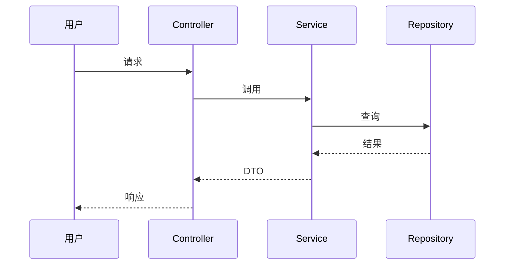

**场景 2：【含外部系统调用】**　**场景 3：【异常 / 失败流程】**

<!-- 三个场景必须覆盖：一个跨模块、一个含外部系统、一个失败流程。每个图后用文字说明关键分支。 -->

### 3.7 模块职责与依赖矩阵

| 模块 | 职责 | 依赖的模块 | 被谁依赖 | 对外接口数 |
|------|------|-----------|---------|-----------|
| | | | | |

**循环依赖检查结论**：【通过 / 存在环：A→B→C→A，已通过 ______ 消除】

### 3.8 本节自检

- [ ] 一级模块 ≥6 个，且模块间职责内聚、边界清晰
- [ ] 无反向依赖、无跨层调用
- [ ] 类图实体与 4.1 节 ER 图一致
- [ ] 时序图覆盖跨模块 / 外部系统 / 异常流程
- [ ] 依赖矩阵无环

---

## 4 数据架构视图（Data View）

> **关注点**：数据如何组织、存储、流转、一致化与保护？

### 4.1 ER 图（≥10 个实体）

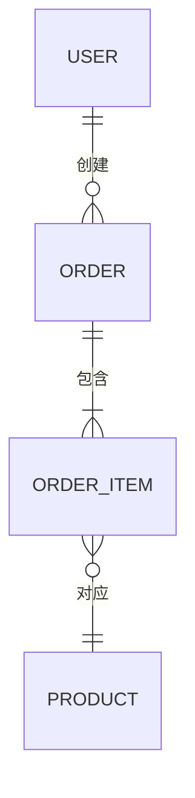

### 4.2 数据字典（核心表 ≥10 张）

**表名：t_xxx（中文名）**

| 字段 | 类型 | 长度 | 约束 | 默认值 | 业务含义 |
|------|------|------|------|-------|---------|
| id | BIGINT | — | PK, 自增 | — | 主键 |
| | | | | | |

<!-- 每张核心表一张此表。字段说明不能只写"名称"，要写业务含义。 -->

### 4.3 存储选型矩阵

| 数据类别 | 举例 | 存储方案 | 选型理由 | 被否决的备选 |
|---------|------|---------|---------|-------------|
| 结构化业务数据 | 订单、用户 | MySQL | 事务与关系查询 | MongoDB（弱事务） |
| 高频读数据 | 首页配置 | Redis | | |
| 文件 | 图片、附件 | 对象存储 | | |
| 检索数据 | 全文搜索 | | | |

### 4.4 数据分布与读写策略

| 策略 | 本期是否实现 | 触发条件（什么量级下启用） | 预留设计 |
|------|------------|------------------------|---------|
| 读写分离 | | | |
| 分库分表 | | | |
| 冷热分离 | | | |

### 4.5 数据流转图

<!-- 描述一个核心业务的完整数据路径：写入 → 同步 → 缓存失效 → 归档。 -->

### 4.6 一致性方案

| 场景 | 一致性要求 | 实现机制 | 失败补偿 |
|------|-----------|---------|---------|
| 【如：下单扣库存】 | 强一致 / 最终一致 | 本地事务 / 消息队列 + 幂等 | |

**幂等设计**：【如何保证重复提交不产生脏数据？列出幂等 Key 与去重表设计。】

### 4.7 缓存设计

| 缓存对象 | Key 设计 | 粒度 | 过期策略 | 更新时机 |
|---------|---------|------|---------|---------|
| | | | | |

**缓存三问**：穿透→【______】；击穿→【______】；雪崩→【______】

### 4.8 数据安全与合规

| 项目 | 措施 |
|------|------|
| 密码存储 | BCrypt 加盐哈希 |
| 敏感字段 | 【脱敏/加密方式】 |
| 备份策略 | 全量 / 增量周期，RPO = ______，RTO = ______ |
| 访问控制 | |
| 日志留存 | |

### 4.9 本节自检

- [ ] ER 图实体 ≥10 个，数据字典 ≥10 张表
- [ ] ER 图与实际建表脚本**完全一致**（评审会核对）
- [ ] 有缓存设计与一致性方案
- [ ] 敏感数据有明确处理措施

---

## 5 开发架构视图（Development View）

> **关注点**：代码如何组织？如何构建、测试、发布？

### 5.1 技术栈选型

| 层次 | 技术 | 版本 | 选型理由 | 被否决的备选及原因 |
|------|------|------|---------|------------------|
| 前端 | | | | |
| 后端 | | | | |
| 数据库 | | | | |
| 缓存 | 0 | | | |
| 消息 | | | | |
| 构建 | | | | |
| 测试 | | | | |

### 5.2 源码目录结构

```
project/
├── backend/
│   ├── controller/     # 接入层：参数校验、路由、异常转译
│   ├── service/        # 应用层：用例编排、事务边界
│   ├── domain/         # 领域层：实体、值对象、领域服务
│   ├── repository/     # 基础设施层：持久化实现
│   └── config/         # 配置
├── frontend/
└── docs/api/
```

**目录职责说明**

| 目录 | 职责 | 对应逻辑视图的哪一层 / 哪个模块 |
|------|------|---------------------------|
| | | |

<!-- 这一栏是评审重点：目录结构必须能映射回第 3 章的分层与模块划分。 -->

### 5.3 模块依赖图

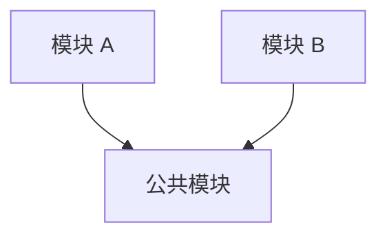

| 禁止的依赖方向 | 理由 |
|--------------|------|
| | |

### 5.4 第三方依赖清单

| 依赖 | 版本 | 用途 | 许可证 | 备注 |
|------|------|------|-------|------|
| | | | | |

**风险检查**：【是否存在版本冲突 / 已知漏洞 / 过重依赖？】

### 5.5 配置与环境管理

| 环境 | 用途 | 数据库 | 域名 | 配置来源 |
|------|------|-------|------|---------|
| dev | | | | |
| test | | | | |
| prod | | | | |

**密钥管理**：【禁止明文入库。说明采用环境变量 / 配置中心 / 密钥文件的哪种方式。】

### 5.6 构建与 CI/CD

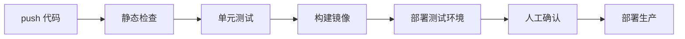

| 阶段 | 工具 | 卡点（失败即中断） |
|------|------|------------------|
| | | |

### 5.7 编码规范与质量门禁

| 项 | 规范 |
|----|------|
| 命名 | 类名大驼峰、方法小驼峰、常量全大写 |
| 异常 | 统一业务异常 + 全局处理器，禁止捕获后吞掉 |
| 日志 | Slf4J，禁止 System.out.println，禁止打印敏感信息 |
| 事务 | 仅标注在应用层方法 |
| 注释 | 公开方法必须有 Javadoc |
| 单测覆盖率 | ≥ ______% |

### 5.8 版本管理策略

- 分支模型：【Git Flow / Trunk Based / GitHub Flow】
- 提交信息规范：Conventional Commits（`feat/fix/docs/refactor/test/chore`）
- 版本号规则：语义化版本 `MAJOR.MINOR.PATCH`

### 5.9 测试策略

| 层级 | 占比 | 工具 | 示例 |
|------|------|------|------|
| 单元测试 | 70% | | |
| 集成测试 | 20% | | |
| 端到端 | 10% | | |

**测试数据准备**：【如何构造？如何保证可重复执行？】

### 5.10 AI 辅助开发方案与 Skill 包

**AI 使用环节**：

| 环节 | 是否使用 AI | 说明 |
|------|-----------|------|
| 代码骨架生成 | 是 | 由 Skill 约束分层与命名 |
| 文档撰写 | | |
| 图表绘制 | | |
| 调试排错 | | |

**Skill 包清单**

| Skill 名称 | 触发场景 | 强制约束 | 附带资产 |
|-----------|---------|---------|---------|
| project-scaffold | 初始化模块/环境 | | |
| module-generator | 新增业务模块 | 分层依赖规则 R-01~R-03 | templates/ scripts/ |
| arch-doc-sync | 代码 → 文档同步 | | |

<!-- 详细要求见任务书第五章。Skill 中写死的规范必须与 5.2、5.7 完全一致。 -->

### 5.11 本节自检

- [ ] 目录结构与第 3 章分层 / 模块一一对应
- [ ] 有 CI 流程与质量门禁
- [ ] 有测试策略且可运行
- [ ] Skill 约束 = 本节规范

---

## 6 运行架构视图（Runtime / Process View）

> **关注点**：运行时有哪些进程/服务？如何通信、并发、容错？性能与容量如何？

### 6.1 运行时进程视图

| 进程/服务 | 职责 | 实例数 | 端口 | 通信协议 | 资源占用 |
|----------|------|-------|------|---------|---------|
| | | | | | |

### 6.2 并发与线程模型

- 请求处理链路：【如 Tomcat 线程池 → Service → HikariCP 连接池】
- 关键参数：线程池核心/最大 = 【__/__】；连接池 = 【__】
- 阻塞边界：【哪些操作会阻塞线程，如何处理】

### 6.3 关键运行时场景时序图（≥3 个，且与 3.6 不重复）

**场景 1：【并发场景，如秒杀/抢座】**

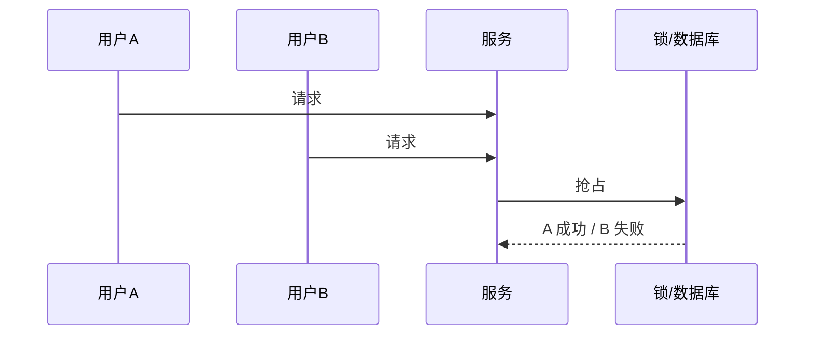

**场景 2：【异步任务】**　**场景 3：【缓存失效重建 / 服务降级】**

### 6.4 核心对象状态机

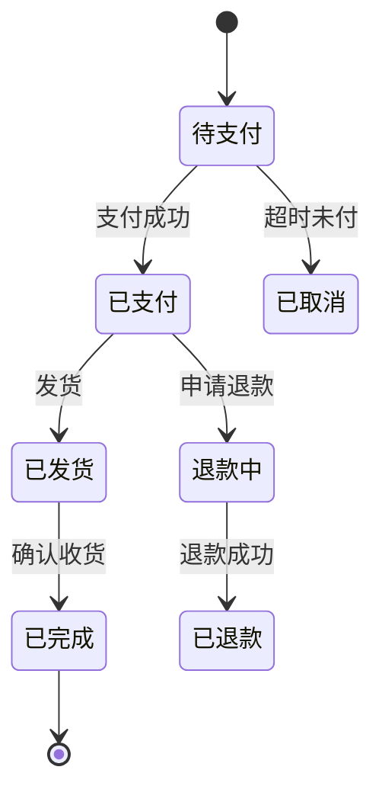

| 状态 | 可迁移到 | 触发条件 | 副作用 |
|------|---------|---------|-------|
| | | | |

### 6.5 异步与消息设计

| 主题/队列 | 生产者 | 消费者 | 投递语义 | 重试策略 | 死信处理 |
|----------|-------|-------|---------|---------|---------|
| | | | 至少一次 / 至多一次 | | |

### 6.6 性能与容量估算

**假设**：DAU = 【____】，峰值 QPS = 【____】，日增数据 = 【____】

**计算过程**（必须写出公式）：

```
峰值 QPS = DAU × 活跃比例 × 人均请求数 / 有效秒数
        = ____ × ____ × ____ / ____
        = ____ QPS
单实例处理能力 = ____ QPS（压测/经验值）
所需实例数 = ceil(峰值 QPS / 单实例能力 × 冗余系数) = ____
```

**瓶颈点**：【______】　**优化手段**：【______】

### 6.7 并发控制方案

| 冲突场景 | 方案（乐观锁/分布式锁/唯一约束/幂等表） | 具体实现 | 失败后行为 |
|---------|--------------------------------|---------|-----------|
| | | | |

### 6.8 容错、降级与限流

| 机制 | 应用位置 | 阈值 | 触发后行为 |
|------|---------|------|-----------|
| 超时 | | | |
| 重试 | | | |
| 熔断 | | | |
| 降级 | | | |
| 限流 | | | |

### 6.9 可观测性

| 类别 | 内容 |
|------|------|
| 日志 | 分级规范、traceId 贯穿、敏感信息脱敏 |
| 指标 Metrics | 【QPS / 响应时间 / 错误率 / 队列长度】 |
| 链路追踪 | |
| 告警规则 | |

### 6.10 安全运行机制

| 项 | 方案 |
|----|------|
| 认证 | JWT / Session / OAuth2 |
| 鉴权 | RBAC，拦截位置 = ______ |
| 防重放 | |
| 防注入 | 预编译参数绑定 |
| 传输安全 | HTTPS |

### 6.11 本节自检

- [ ] 运行视图的图与逻辑视图**不重复**
- [ ] 有状态机、有容量估算（带公式）
- [ ] 有并发冲突解决方案
- [ ] 有限流降级熔断

---

## 7 物理架构视图（Physical View）

> **关注点**：软件如何映射到硬件与网络？如何部署、扩容、容灾？

### 7.1 部署拓扑图

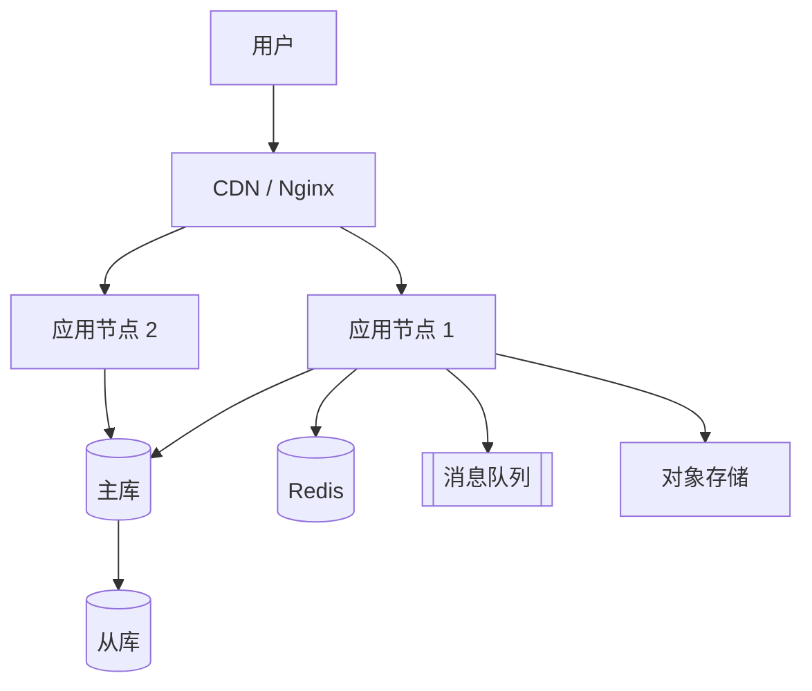

### 7.2 节点与资源配置清单

| 节点 | 角色 | CPU | 内存 | 磁盘 | 带宽 | OS | 软件版本 |
|------|------|-----|------|------|------|-----|---------|
| | | | | | | | |

### 7.3 网络与安全域

| 安全域 | 内容 | 开放端口 | 访问来源 |
|-------|------|---------|---------|
| 公网区 | | 80/443 | 任意 |
| 应用区 | | | 仅内网 |
| 数据区 | | | 仅应用区 |

- HTTPS 终止位置：【CDN / Nginx / 应用】
- 防火墙与 WAF 策略：【______】

### 7.4 部署方案与制品

| 制品 | 构建方式 | 镜像大小 | 配置注入方式 |
|------|---------|---------|-------------|
| | | | |

**部署命令 / 清单**：【贴出 docker-compose.yml 或 k8s 关键片段】

### 7.5 高可用与容灾

| 组件 | 是否单点 | 消除方式 | 故障转移时间 |
|------|---------|---------|-------------|
| | | | |

- RTO 目标 = 【______】；RPO 目标 = 【______】
- 备份策略与恢复演练：【______】

### 7.6 环境规划

| 环境 | 资源规模 | 数据来源 | 说明 |
|------|---------|---------|------|
| dev | | 造数 | |
| test | | 脱敏数据 | |
| prod | | 真实数据 | |

### 7.7 扩容策略

| 组件 | 扩容方式 | 触发条件 | 操作步骤 | 难点 |
|------|---------|---------|---------|------|
| 无状态应用 | 水平 | CPU > 70% 持续 5min | | 无 |
| 数据库 | | | | 有状态，需主从切换 |

### 7.8 成本估算

| 资源 | 规格 | 数量 | 单价（月） | 小计 |
|------|------|------|-----------|------|
| | | | | |
| **合计** | | | | **￥______** |

**在预算约束下做的取舍**：【放弃了什么，为什么可以接受】

### 7.9 实际部署验证

| 项 | 内容 |
|----|------|
| 访问地址 | |
| 部署方式 | Docker Compose / K8s / 手工 |
| 部署耗时 | |
| 部署过程记录 | 见附录【__】截图 |
| 监控/日志后台截图 | 见 screenshots/ |

### 7.10 本节自检

- [ ] 部署图包含完整链路（客户端→负载→应用→数据→中间件）
- [ ] 有资源清单与成本估算
- [ ] 单点已消除或明确说明为何保留
- [ ] 实际可访问

---

## 8 五视图一致性追溯

### 8.1 追溯矩阵（≥10 条核心需求）

| 需求 ID | 需求描述 | 逻辑单元 | 数据实体 | 代码模块 | 运行时进程 | 部署节点 | 对应 ADR |
|---------|---------|---------|---------|---------|-----------|---------|---------|
| FR-01 | | | | | | | |
| FR-02 | | | | | | | |
| …… | | | | | | | |

### 8.2 三个必答问题

**问题 1：设计过程中，哪个视图的约束反过来修改了另一个视图的决策？举一个真实例子。**

【答：______。例如在绘制运行视图时发现 ______ 存在并发冲突，于是在数据视图中改为 ______，这又导致逻辑视图的 ______ 接口签名调整。】

**问题 2：你的最高优先级质量属性是什么？它在五个视图中分别如何体现？**

| 视图 | 该质量属性的体现 |
|------|----------------|
| 逻辑 | |
| 数据 | |
| 开发 | |
| 运行 | |
| 物理 | |

**问题 3：若用户量增长 10 倍，你需要改动哪些视图的哪些部分？列出最小变更集。**

| 视图 | 需改动的部分 | 工作量 |
|------|------------|-------|
| | | |

---

## 附录 A：架构决策记录（ADR）明细

> 每条采用统一模板，≥8 条。模板见任务书附录 B。

### ADR-001：后端框架选型

- 日期：　　　状态：已接受　　　涉及视图：开发 / 运行

**背景**：【为什么必须做这个决策？约束是什么？】

**备选方案**

| 方案 | 优点 | 缺点 |
|------|------|------|
| A | | |
| B | | |

**决策**：【选择了什么】

**理由**：【为什么选它，放弃了什么，代价是什么】

**影响**：【对哪些视图、哪些质量属性产生影响】

**验证方式**：【如何证明决策正确，何时需重新评估】

<!-- 以下重复 ADR-002 ~ ADR-00N -->

---

## 附录 B：图例与建模约定

- 建模语言：【UML 2.5 / C4 模型】，全文统一
- 绘图工具：【draw.io / PlantUML / Mermaid】
- 图形约定：【如：实线箭头 = 依赖，虚线 = 异步消息】

## 附录 C：核心代码索引

| 架构元素 | 代码位置 | 说明 |
|---------|---------|------|
| 分层边界 | `backend/controller/` | |
| 领域模型 | | |
| 状态机实现 | | |
| 缓存实现 | | |
| 消息生产者 | | |

<!-- 这张表是答辩时"代码走查"环节的索引，证明文档与代码一致。 -->

## 附录 D：参考文献

1. 【作者. 书名/文章名. 出版社/来源, 年份】
2. …

<!-- ≥10 篇，近三年 ≥4 篇，英文 ≥2 篇。 -->
